# So arbeitet er

Der Pager ist ein Cloudflare Worker mit drei Türen und einem Zeitplan: `/github` für die Ereignisse der GitHub-App, `/telegram` für die Updates des Bots, `/control` für die Antworten des privaten Steuer-Repositorys, und ein Lauf alle 15 Minuten. Jede Anfrage beweist, woher sie kommt, bevor irgendetwas anderes läuft. In einem Lauf des Zeitplans gehen jeder Schritt und jede Sache eines Schritts für sich: Eine Sache, die Telegram oder GitHub ablehnt oder die ein abbrechendes Netz aufhält, kostet nur sich selbst, steht im Log des Workers und kommt im nächsten Lauf wieder, während die anderen Sachen und die späteren Schritte weiterlaufen, vor allem die gescheiterten Ereignisse. Es kommen so viele Sachen wieder, wie die Aufrufe eines Laufs erlauben, acht für jede, und der Rest wartet auf den nächsten Lauf ([Entscheidung 0023](decisions/0023-a-thing-that-fails-in-a-run-of-the-schedule-costs-only-itself.md)).

<picture>
  <source media="(prefers-color-scheme: dark)" srcset="images/diagrams/how-the-pager-works.de.dark.svg">
  
</picture>

## Was zählt

`src/rules.ts` ist die eine Stelle, die entscheidet; ihre Tests gehen jede Regel durch. Ein Ereignis aus einem Repository eines anderen Besitzers oder einer Art, die hier nicht steht, endet ohne Nachricht.

| Ereignis | Zählt, wenn | Wird zu |
| --- | --- | --- |
| `issues` opened, `pull_request` opened | Der Autor ist weder der Maintainer (`MAINTAINER_LOGIN`) noch ein Bot | Ein Beitrag, je eine Nachricht |
| `discussion` created, `discussion_comment` created | Der Autor ist weder der Maintainer noch ein Bot, die Diskussion ist keine des Maintainers, und keine Antwort von Q&A wurde gewählt | Ein Beitrag mit sofortigem Entwurf, einer pro Diskussion; ein neuer Kommentar wird zur Nachricht, auf die die Antwort antwortet ([unten](#eine-diskussion)) |
| `discussion` answered, closed oder deleted; `discussion_comment` created vom Maintainer | Die Diskussion ist keine des Maintainers | Ihre offene Sache ist erledigt, und ihre Nachricht sagt, warum ([unten](#eine-diskussion)) |
| `issue_comment` created | Der Autor ist weder der Maintainer noch ein Bot, zu einem Issue oder Pull Request von keinem von beiden | Die neueste Nachricht ihres Beitrags: Eine offene Sache nennt ihn an Ort und Stelle und benachrichtigt einmal, eine Sache, deren Antwort gesendet ist oder um die sich GitHub gekümmert hat, öffnet wieder, und eine unbekannte kommt neu ([unten](#ein-kommentar-zu-einem-issue-oder-pull-request)) |
| `issue_comment` created vom Maintainer; `issues` closed; `pull_request` closed, gemergt oder nicht | Das Issue oder der Pull Request ist weder des Maintainers noch eines Bots | Ihre offene Sache ist erledigt, und ihre Nachricht sagt, warum ([unten](#ein-kommentar-zu-einem-issue-oder-pull-request)) |
| `check_run` completed auf dem Standard-Branch | Die Rulesets des Branches verlangen den Check, er ist fehlgeschlagen, abgelaufen oder nicht gestartet, und er ist kein Job von GitHub Actions, dessen Lauf sich als sein Workflow meldet | Ein Eintrag im Alarm des Repositorys; ein Erfolg desselben Checks nimmt ihn heraus |
| `workflow_run` completed | `release.yml`, `build-release.yml` oder `verify-release.yml` ist gescheitert, außerhalb eines Pull Requests | Ein Eintrag im Alarm; ein Erfolg, der zu dem Fehlschlag gehört, nimmt ihn heraus: ein späterer Versuch des gescheiterten Laufs, ein Lauf, der von Hand gestartet wurde, oder jeder Erfolg, nach dem kein Release mehr ein Entwurf ist |
| `workflow_run` completed auf dem Standard-Branch | Jeder andere Workflow ist gescheitert, abgelaufen oder nicht gestartet, in einem Lauf des Repositorys selbst außerhalb eines Pull Requests, etwa nach einem Push, nach einem Zeitplan, von einem Bot oder von Hand gestartet | Eine Nachricht pro Workflow, sobald ein Neustart nicht half; jeder Lauf, der wieder scheitert, ändert sie, und ein Lauf, der die gescheiterten Jobs besteht, macht sie ✅ ([unten](#ein-workflow-der-auf-main-scheitert)) |
| `issues` opened von einem Bot | Es trägt das Label `bot-failure` des Bot-Health-Bots | Der Pager liest den Lauf, den das Issue nennt, und nimmt ihn als das Ende dieses Laufs seines Workflows, auch bei jeder Änderung, wie der Bot sie bei jedem neuen Fehlschlag macht: Ein Fehlschlag, den der Pager hatte, ändert nichts, und einer, den er verpasste, meldet sich jetzt. Ohne einen Lauf, den er lesen kann, ein Eintrag im Alarm, den eine Änderung ändert und das Schließen des Issues herausnimmt. Das Issue *Upload the new social preview*, mit dem Schlüssel `social-preview` in seiner Markierung, nennt keinen Lauf, und nichts scheitert: Der Bot hält es offen, solange GitHub ein anderes Bild zeigt als das committete `.github/social-preview.png`, das nur ein Mensch hochladen kann, also sagt sein Eintrag *🖼 Lade die neue Social Preview hoch* und verlinkt das Issue, mit dem Bild zum Speichern und dem Weg zu den Einstellungen. 🛠 Fix starten kann das Bild nicht hochladen: Ein Alarm nur mit diesem Eintrag, oder mit diesem Eintrag und scheiternden Ereignissen von GitHub, bietet es nicht an, und 🛠 Fix starten eines Alarms mit weiteren Einträgen lässt ihn weg |
| `code_scanning_alert` created, appeared_in_branch oder reopened auf dem Standard-Branch | Der Schweregrad ist high oder critical, und niemand hat die Warnung verworfen | Ein Eintrag in der Sicherheitsnachricht des Repositorys; behoben oder verworfen nimmt ihn heraus. Eine Warnung, die Code Scanning zuerst in einem Pull Request fand, kommt als appeared_in_branch, sobald der Merge sie auf den Standard-Branch bringt |
| `secret_scanning_alert` created, reopened oder publicly_leaked | Die Warnung ist nicht behoben | Ein Eintrag in der Sicherheitsnachricht des Repositorys, mit der Art seines Secrets und seiner Datei, nie dem Secret; resolved nimmt ihn heraus ([unten](#eine-vertrauliche-meldung-und-ein-geleaktes-secret)) |
| `repository_advisory` reported | Eine vertrauliche Meldung einer Sicherheitslücke | Eine eigene Sache, *🔐 Sicherheitslücke gemeldet*, mit ihrem Schweregrad, ihrem Link und den Tagen von `SECURITY.md`, nie dem, was sie sagt ([unten](#eine-vertrauliche-meldung-und-ein-geleaktes-secret)) |
| `repository_advisory` published | Es ist eine Meldung, die der Pager zeigt | Dieselbe Nachricht: *✅ Veröffentlicht* |
| `check_suite` completed auf einem Branch von release-please, oder sein `pull_request` edited | GitHub nennt den Pull Request clean: offen, aus dem Repository selbst, kein Entwurf, in den Standard-Branch, jeder Pflicht-Check grün und aktuell | Die Release-Nachricht mit ihren Versionshinweisen und 🔀 **Mergen**; neue Versionshinweise am selben Head ändern sie an Ort und Stelle |
| `pull_request` synchronize, closed und merged; `release` published | Es ist das Release, das die Nachricht zeigt | Dieselbe Nachricht: *aktualisiert*, *gemergt*, *✅ veröffentlicht* |
| `workflow_run` completed | `visual.yml`, der Visual Check, ist auf einem Pull Request des Repositorys an seinem Head grün, der einer des Maintainers oder eines Bots ist, und ein Bild sieht anders aus | Die Bilder, die anders aussehen, zuerst ihre geänderten Pixel rot, dann vorher und nachher, im Thema des Releases oder einer eigenen Sache ([unten](#die-bilder-einer-sichtbaren-änderung)) |
| `pull_request` closed | Es ist einer des Maintainers oder eines Bots, dessen Bilder der Pager zeigt | Seine Bilder sind erledigt: ✅ vor ihrem Thema |

Ein Bündel, dessen letzter Eintrag verschwunden ist, wird von selbst grün, und ein neuer Fehler danach öffnet eine neue Nachricht, die benachrichtigt. Ein neuer Eintrag eines offenen Bündels, etwa ein Release, das scheitert, während ein Check des Alarms auf seinen Fix wartet, oder ein geleaktes Secret, während eine Warnung des Code Scannings das tut, ist ebenso neu ([Entscheidung 0022](decisions/0022-a-new-entry-of-an-open-bundle-notifies-once.md)): Die Nachricht, an Ort und Stelle geändert, listet ihn, und eine kurze Nachricht darunter in ihrem Thema, *🚨 Neu in diesem Alarm* oder *🛡 Neu in dieser Sicherheitsmeldung* mit dem Eintrag, benachrichtigt, denn eine Änderung benachrichtigt niemanden. Die neuen Einträge der zehn Minuten nach einer Benachrichtigung des Bündels, etwa nach einem Push, der ein paar Checks bricht, oder die Warnungen einer neuen Abfrage des Code Scannings, kommen leise, und ein Bündel, das ⏰ **Später** zurückgestellt hat, kommt sofort zurück. Ein Eintrag, den es schon gibt und der sich ändert, etwa ein Check, der erneut scheitert, ändert die Nachricht leise, und die zweite Zustellung desselben Ereignisses durch GitHub ändert nichts. Ein Eintrag im Alarm behält den Lauf von GitHub Actions, der scheiterte, wo er einen nennt: ein Release-Lauf über seine ID und ein Issue des Bot-Health-Bots, dessen Lauf der Pager nicht lesen kann, über den Lauf in der Markierung seines Textes, `<!-- bot-health {"run": 31, …} -->`, die der Bot bei jedem Fehlschlag neu schreibt. Ein solcher Eintrag gibt dem Alarm 🔁 **Neu starten**. Der Eintrag eines Release verlässt den Alarm nur mit einem Erfolg, der zu seinem Fehlschlag gehört: Ein Lauf nach einem Push oder nach dem Zeitplan ist grün, sobald er nichts zu veröffentlichen findet, auch während das gescheiterte Release noch ein Entwurf ist, den nur ein Lauf von Hand oder ein späterer Versuch des gescheiterten Laufs aufnimmt. Darum nehmen ein späterer Versuch des gescheiterten Laufs, etwa von 🔁 Neu starten, und ein Lauf, der von Hand gestartet wurde, den Eintrag heraus; jeder andere Erfolg nimmt ihn nur heraus, wenn keines der zehn neuesten Releases des Repositorys mehr ein Entwurf ist, was der Pager mit einem Token der App für `contents: write` liest, denn GitHub zeigt Entwürfe nur einem Token, das die Inhalte schreiben darf. Releases, die sich nicht lesen lassen, behalten den Eintrag. Ein Entwurf, den der Maintainer mit Absicht behält, etwa einer, den er von Hand angelegt hat, hält den Eintrag eines Releases genauso, bis ein späterer Versuch des gescheiterten Laufs oder ein Lauf, der von Hand gestartet wurde, ihn herausnimmt.

Eine Nachricht zeigt, was ihre Sache sagt, sodass sie keinen Besuch auf GitHub braucht. Ein Beitrag zitiert die ersten 500 Zeichen seines Issues, Pull Requests, seiner Diskussion oder seines Kommentars, ohne die HTML-Kommentare seines Formulars, maskiert und eingeklappt als `<blockquote expandable>`, in dem Platz, den sein Entwurf und seine Notiz unter den 4096 Zeichen von Telegram lassen. Ein Release zeigt die Versionshinweise seines Pull Requests, nach `<!-- The notes of the release follow. -->` oder sonst dem ersten `---`: Überschriften fett, Punkte als *• Text #56* mit verlinkter Nummer und ohne die Links auf Commits, höchstens 15 Zeilen oder 1200 Zeichen und *… und N weitere* für den Rest, unter *⚠️ Inkompatible Änderungen*, wenn die Versionshinweise einen Abschnitt inkompatibler Änderungen haben oder die Hauptversion ab 1 steigt. Ein Pager, der eine andere Sprache als Englisch spricht, zeigt sie in seiner, wie [die Versionshinweise in deiner Sprache](#die-versionshinweise-in-deiner-sprache) sagen.

## Die Versionshinweise in deiner Sprache

Die Repositorys schreiben ihre Changelogs auf Englisch, und GitHub behält sie so. Ein Pager auf Deutsch zeigt die Versionshinweise eines Release trotzdem auf Deutsch ([Entscheidung 0020](decisions/0020-the-notes-of-a-release-come-in-the-language-of-the-pager.md)):

- **Die Überschriften sofort,** aus dem Katalog des Pagers: die Arten von Änderungen von release-please, der Blueprint und Keep a Changelog, etwa *Neue Funktionen* für *Features*, *Fehlerbehebungen* für *Bug fixes* oder *Bug Fixes* und *⚠ Inkompatible Änderungen* für *⚠ BREAKING CHANGES*. Eine Überschrift, die keine Art von Änderung nennt, bleibt, wie sie ist.
- **Die Punkte eine Minute später,** vom Steuer-Repository: Sobald die Nachricht auf Englisch hinausging, schickt der Pager `pager-translate` mit den Worten jedes Punkts und Textes, ohne seinen Bereich, etwa `deps:`, der bleibt, wie er ist, und das Claude des Steuer-Repositorys übersetzt sie mit dem Abo des Maintainers, nie mit einem API-Key. Seine Antwort bearbeitet die Nachricht an Ort und Stelle, was niemanden benachrichtigt.
- **Geprüft, Zeile für Zeile:** Eine übersetzte Zeile, die einen Verweis wie #791 oder einen Namen aus Code wie `anchore/syft`, `v1.56.0`, `node_modules` oder `.github` verloren hat, die nichts sagt oder länger als 450 Zeichen ist, behält ihr Englisch; eine Antwort mit einer anderen Zahl von Zeilen oder mit mehr als 2400 Zeichen insgesamt ändert nichts.
- **Einmal pro Versionshinweise:** Der Eintrag des Release behält die Übersetzung, sodass eine spätere Änderung seiner Nachricht, etwa *gemergt* oder ein neuer Head mit denselben Versionshinweisen, nicht noch einmal fragt. Versionshinweise, die sich ändern, etwa durch eine Bearbeitung des Pull Requests, fragen neu, und ebenso ein Pager, der seither eine andere Sprache spricht; bis seine Antwort kommt, zeigt er das Englisch. Eine Frage, die scheiterte, etwa an einem kaputten Netz, geht noch einmal mit dem Ereignis, das GitHub erneut zustellt, oder mit der nächsten Prüfung des Release.
- **Englisch, wenn sie nicht kommt:** Ein Steuer-Repository, das nicht antwortet, oder eines ohne den Job für `pager-translate` lässt das Englisch stehen, und ebenso ein Pager auf Englisch, der nichts fragt.

<picture>
  <source media="(prefers-color-scheme: dark)" srcset="images/diagrams/the-notes-of-a-release.de.dark.svg">
  
</picture>

## Die Knöpfe

`src/buttons.ts` ist die Positivliste: Jede Art von Sache bietet diese Knöpfe in diesen Zuständen an, und ein Druck wirkt nur, wenn die Sache, so wie sie zur Zeit des Drucks ist, ihn noch anbietet.

| Sache | Zustand | Knöpfe |
| --- | --- | --- |
| Beitrag | new | ✍️ Antwort entwerfen, 🤖 Assistent nochmal (nur Issues), ⏰ Später, ✖ Ignorieren |
| Beitrag | drafting | ⏰ Später, ✖ Ignorieren |
| Beitrag | draft | ✅ Senden, ✏️ Bearbeiten, ⏰ Später, ✖ Ignorieren |
| Diskussion | new | ✍️ Antwort entwerfen, ✖ Ignorieren, nur wenn ihr Entwurf nicht angefragt werden konnte oder sein Job fehlschlug oder nicht innerhalb der Stunde antwortete |
| Diskussion | drafting | ✖ Ignorieren |
| Diskussion | draft | ✅ Senden, ✏️ Bearbeiten, ✖ Ignorieren |
| Beitrag, Diskussion | sent, done, ignored | Keine; ein neuer Kommentar von jemand anderem öffnet eine gesendete oder erledigte wieder: ein Issue oder einen Pull Request mit den Knöpfen von *new*, eine Diskussion gleich mit ihrem Entwurf (*drafting*) |
| Alarm | open | 🔁 Neu starten (wo ein Eintrag einen Lauf nennt), 🛠 Fix starten (außer wenn jeder Eintrag ein scheiterndes Ereignis von GitHub oder das Hochladen der Social Preview ist), ⏰ Später, ✖ Ignorieren |
| Sicherheit | open | 🛠 Fix starten (außer wenn jeder Eintrag ein Secret ist), ⏰ Später, ✖ Ignorieren |
| Alarm, Sicherheit | fixing | ⏰ Später, ✖ Ignorieren |
| Gemeldete Sicherheitslücke | open | ⏰ Später, ✖ Ignorieren |
| Workflow | failing | 🔁 Neu starten, ✖ Ignorieren |
| Workflow | rerunning | ✖ Ignorieren |
| Release | ready | 🔀 Mergen, ⏰ Später, ✖ Ignorieren |
| Bilder | open | ✖ Ignorieren |
| Erinnerung | open | ✅ Erneuert, ⏰ Später |
| Frage eines Agenten | open | Ein Knopf pro Option (kein ⏰ Später, kein ✖ Ignorieren) |

- **🔀 Mergen** fragt GitHub erneut nach dem Pull Request und merged ihn per Squash nur an dem Stand, den die Nachricht zeigte, solange er noch clean ist; ein geändertes Release wartet wieder auf seine Checks.
- **✅ Senden** postet den Entwurf, dessen Version sein Knopf trägt, genau so, wie die Nachricht ihn zeigte, im Namen des Maintainers, und in einer Diskussion als App; ein älterer Knopf derselben Sache lehnt ab. **✏️ Bearbeiten** bittet um den neuen Text als Antwort auf seine Rückfrage und zeigt ihn als nächsten Entwurf, der von da an der eigene des Maintainers ist: Kein Entwurf des Steuer-Repositorys ersetzt ihn, auch nicht der eines Jobs, der noch läuft.
- **🤖 Assistent nochmal** startet den Workflow `issue-assistant.yml` des Repositorys auf dem Issue mit `override`, im Namen des Maintainers. Ein Repository, dessen Issue-Assistent den Override noch nicht kennt, antwortet mit 422, und der Knopf sagt das.
- **🔁 Neu starten** liest jeden Lauf, den die Einträge nennen, mit einem Token der App für `actions: read`, und startet seine gescheiterten Jobs erneut, wie *Re-run failed jobs* auf GitHub, mit einem Token für `actions: write`. Ein Lauf, der noch läuft oder dessen neuerer Versuch läuft, und einer, der bei einem neuen Versuch schon grün wurde, bleiben, wie sie sind, und der Knopf sagt das. Die Einträge eines Laufs, der erneut läuft, zeigen *🔁 läuft erneut …* in der Nachricht, die sich an Ort und Stelle ändert, bis der Lauf wieder scheitert oder grün wird: Ein Erfolg schließt das Issue des Bot-Health-Bots oder beendet den Fehlschlag des Releases, was den Eintrag herausnimmt, und der letzte macht den Alarm ✅. Der Knopf kostet keinen Lauf von Claude, daher steht er vorn, für einen kurzen Ausfall von GitHub, etwa einen Download, der mit 504 antwortete. In der Nachricht eines [Workflows](#ein-workflow-der-auf-main-scheitert) startet er die gescheiterten Jobs des neuesten gescheiterten Laufs erneut, nach demselben Blick, und die Nachricht sagt *🔁 Die gescheiterten Jobs laufen erneut …*, bis der Lauf wieder scheitert, was sie ändert, oder grün wird, was sie ✅ macht.
- **✍️ Antwort entwerfen** und **🛠 Fix starten** schicken die Sache an das Steuer-Repository, dessen Antwort wie unten beschrieben zurückkommt. Jeder ist ein Lauf von Claude mit dem Abo des Maintainers, der auf dessen Wochenlimit zählt, und die Antwort nennt sein Modell, seinen Aufwand und seine Tokens; ein Fix, der in den Logs einen Ausfall von GitHub oder eines Downloads findet, etwa eine 504, eine Zeitüberschreitung oder `error connecting to api.github.com`, ändert nichts und schlägt 🔁 **Neu starten** mit einem Knopf ✅ **Bestätigen** vor; ein Job, der fehlschlägt, bringt seinen Knopf zurück, und ebenso ein Job, der binnen einer Stunde keine Antwort schickte: Der Zeitplan gibt seiner Sache die Knöpfe einmal zurück, als neue Nachricht mit der Notiz *⌛ Keine Antwort vom Steuer-Repository*.
- **Ein Knopf pro Option** beantwortet die [Frage eines Agenten](#fragen-und-berichte-deiner-agenten) und speichert die Antwort; ein Text in ihrem Thema beantwortet sie in den eigenen Worten des Maintainers.
- **⏰ Später** bringt die Sache nach `LATER_HOURS` als neue Nachricht zurück; **✖ Ignorieren** schließt sie, und ein ignorierter Workflow bleibt still, bis ein Lauf von ihm grün wird.
- **Hat GitHub gehandelt,** behält der Pager das, was immer Telegram antwortet. Ein Knopf, der gemergt, gepostet, einen Lauf von Claude, einen Neustart oder den Issue-Assistenten gestartet oder die Antwort auf eine Frage gespeichert hat, behält den neuen Zustand seiner Sache auch dann, wenn Telegram die Änderung der Nachricht ablehnt, etwa bei einem Ausfall oder mit einem 429, das lange warten lässt: Der Druck bekommt trotzdem seine Antwort, ein zweiter Druck auf einen Knopf, den die alte Nachricht noch zeigt, wird als veraltet abgelehnt, statt auf GitHub zweimal zu handeln, und die nächste Änderung der Sache zeigt die richtige Nachricht.
- **Jeder Druck bekommt eine Antwort.** Ein Druck, dessen Behandlung unerwartet scheitert, etwa wenn Telegram die Änderung der Nachricht ablehnt, bevor GitHub gefragt wurde, Workers KV versagt oder GitHub nicht erreichbar ist, bekommt den Hinweis *😢 Der Pager ist an diesem Druck gescheitert, und ob er gehandelt hat, ist unklar*, statt eines Knopfs, der lädt, bis Telegram aufgibt; sieh dir die Sache auf GitHub an, dann drück noch einmal. Der Fehler geht wie bisher ins Log des Workers.

<picture>
  <source media="(prefers-color-scheme: dark)" srcset="images/diagrams/the-rerun-of-a-run.de.dark.svg">
  
</picture>

## Ein Workflow, der auf main scheitert

GitHub schickt dem Auslöser jedes Laufs, der scheitert, eine Mail, und die Agenten des Pagers handeln als der Maintainer: Ein Workflow, der immer wieder scheitert, etwa einer, dessen Download bei einem Ausfall von GitHub brach, schickt eine Mail pro Lauf. Der Pager meldet ihn einmal, in einer Nachricht pro Workflow, sodass die Mails von GitHub Actions aus sein können ([Einrichten](setup.md#später)).

<picture>
  <source media="(prefers-color-scheme: dark)" srcset="images/diagrams/a-workflow-that-fails.de.dark.svg">
  
</picture>

- **Was zählt:** ein Lauf jedes Workflows außer denen eines Releases, die der Alarm hat, der als *failure*, *timed out* oder *startup failure* auf dem Standard-Branch endet, in einem Lauf des Repositorys selbst außerhalb eines Pull Requests: ein Push, ein Zeitplan, ein Bot wie *Findings* oder *After the checks*, oder ein Start von Hand auf `main`. Ein Lauf eines Pull Requests, eines anderen Branches oder eines Forks bedeutet nichts, ebenso einer, der abgebrochen oder übersprungen wurde: Ein Pull Request zeigt seine Checks selbst. Ein Job von GitHub Actions, den ein Ruleset verlangt, ist ein Teil seines Laufs und meldet sich mit ihm, und ein Issue des Bot-Health-Bots zählt als der Lauf, den es nennt.
- **Erst wenn ein Neustart nicht half:** *After the checks*, der Bot der Checks der Blaupause, startet die gescheiterten Jobs der Tests und eines Releases binnen Minuten noch einmal. Darum wartet der Fehlschlag eines ersten Versuchs ungesehen: Sobald `WAIT` aus `src/pager.ts`, 10 Minuten, um ist, liest der Zeitplan den Lauf. Ein Neustart, der noch läuft, bekommt 10 Minuten mehr, einer, der grün wurde, beendet die Sache ohne Nachricht, und sonst kommt ihre Nachricht, 10 bis 25 Minuten nach dem Fehlschlag. Ein Neustart, der auch scheiterte, der zweite Versuch oder ein späterer, zeigt sich sofort.
- **Eine Nachricht pro Workflow,** etwa *🔴 Docs scheitert auf main in Dennis-Otto/player-switch-for-autodarts*, in einem eigenen Thema: die Jobs, die im zuletzt gescheiterten Versuch scheiterten, höchstens fünf, jeder mit seinem Log verlinkt, oder der Lauf, wenn GitHub sie nicht auflistet, und wann er scheiterte. Jeder Lauf, der wieder scheitert, ändert sie an Ort und Stelle, ohne Benachrichtigung: *3-mal gescheitert seit dem 08.11.2026 um 08:47 UTC, zuletzt am 08.11.2026 um 11:20 UTC.*
- **Wieder grün:** Ein Neustart des gescheiterten Laufs, der grün wird, oder ein neuerer Lauf, in dem kein gescheiterter Job lief, ohne zu bestehen, macht sie ✅. Ein neuerer Lauf, der einen solchen Job übersprang, wie *After the checks* einen Job pro Ereignis ausführt, beendet nichts, und ein Job, den er nicht mehr auflistet, ist aus dem Workflow verschwunden. Der nächste Fehlschlag öffnet eine neue Nachricht in ihrem Thema, die benachrichtigt.
- **🔁 Neu starten** startet die gescheiterten Jobs des neuesten gescheiterten Laufs erneut; **✖ Ignorieren** hält den Workflow still, bis ein Lauf von ihm grün wird.
- **Was es kostet:** Ein Fehlschlag liest die Jobs seines Versuchs einmal, mit einem Token für `actions: read`, und schreibt seine Sache einmal; ein Erfolg liest die Jobs seines Laufs nur, solange sein Workflow scheitert, und schreibt nur, wenn er die Sache beendet. Die App braucht keine neue Berechtigung und kein neues Ereignis: Sie hat `workflow_run` und *Actions* schon.

## Eine Diskussion

Eine neue Diskussion, oder ein Kommentar zu einer, von jemand anderem als dem Maintainer oder einem Bot ist ebenfalls ein Beitrag, mit einem eigenen Thema, etwa *💬 demo#31 How do I start?*. Der Pager bittet das Steuer-Repository sofort um ihren Entwurf, denn ihre Knöpfe senden, bearbeiten oder ignorieren diesen Entwurf, wie [Entscheidung 0006](decisions/0006-a-discussion-gets-its-draft-at-once-and-the-reply-of-the-app.md) erklärt: Die Nachricht zeigt die Diskussion, oder den Kommentar mit seinem Autor, und *✍️ Das Steuer-Repository entwirft eine Antwort …*, und der Entwurf folgt mit ✅ **Senden**, ✏️ **Bearbeiten** und ✖ **Ignorieren**. ✅ Senden postet genau diesen Entwurf mit `addDiscussionComment` der GraphQL-API von GitHub, mit einem Token der App für `discussions: write` dieses einen Repositorys, also erscheint die Antwort als die der App: an der Diskussion selbst, oder im Thread des Kommentars, auf den sie antwortet, was bei einer Antwort auf eine Antwort der Thread ihres Elternkommentars ist, denn GitHub schachtelt nur eine Ebene. Ein Entwurf, der nicht angefragt werden konnte, etwa weil die App nicht auf dem Steuer-Repository installiert ist, lässt die Nachricht mit ✍️ **Antwort entwerfen** und einer Notiz, die sagt, warum.

Eine Diskussion ist eine Sache, mit ihrer Nummer als Schlüssel, die GitHub mit denen der Issues und Pull Requests zusammen zählt. Ein neuer Kommentar von jemand anderem wird zur Nachricht, auf die die Antwort antwortet, mit einem neuen Entwurf: Solange die Sache offen ist, ersetzt eine neue Nachricht die alte, und sobald ihre Antwort gesendet ist, öffnet die Sache wieder in ihrem Thema, in dem die alte Nachricht als Verlauf bleibt. Eine Diskussion, die der Maintainer ignoriert hat, bleibt ignoriert, bis ihr Eintrag 30 Tage später verfällt. Keine Sache kommt von einer Diskussion des Maintainers, samt ihren Kommentaren, denn GitHub benachrichtigt ihren Autor selbst über jeden Kommentar, von einer aus Q&A mit gewählter Antwort, und von den eigenen Antworten der App, die als Kommentare eines Bots zurückkommen.

Eine Diskussion, um die sich GitHub schon gekümmert hat, braucht keine Antwort des Pagers, so wie Bilder keine mehr brauchen, sobald ihr Pull Request geschlossen ist: Wenn der Maintainer auf GitHub selbst antwortet, auf die Diskussion oder in einem ihrer Threads, wenn jemand eine Antwort markiert, oder wenn die Diskussion geschlossen oder gelöscht wird, ist ihre offene Sache erledigt. Ihre Knöpfe gehen, ihr Thema bekommt ✅, und ihre Nachricht sagt, warum, etwa *💬 Du hast auf GitHub geantwortet, also sendet der Pager nichts.*, an Ort und Stelle bearbeitet, was niemanden benachrichtigt. Ein Job, der noch für sie entwirft, findet die Sache erledigt, und sein Entwurf wird nicht gezeigt. Ein neuer Kommentar von jemand anderem öffnet sie danach wieder, wie nach einer gesendeten Antwort, außer eine Antwort wurde gewählt.

Ein Entwurf, den der Maintainer mit ✏️ Bearbeiten geschrieben hat, bleibt seiner ([Entscheidung 0009](decisions/0009-a-discussion-that-github-dealt-with-is-done-and-an-own-draft-stays.md)). Ein Job, der noch entwarf, als sein Text kam, etwa einer für einen neueren Kommentar, ersetzt ihn nicht mehr: Sein Entwurf kommt als Nachricht zum Lesen ohne Knöpfe in das Thema der Sache, und ✅ Senden postet weiter seinen Text. Auch ein neuer Kommentar von jemand anderem behält ihn: Die neue Nachricht zeigt den Kommentar mit seinem Text als Entwurf, eine Notiz sagt es, und kein Job entwirft einen anderen, sodass er ihn mit ✏️ Bearbeiten für den neuen Kommentar ändert.

Das Steuer-Repository führt die Jobs einer Sache nacheinander aus. Ein Kommentar, der kommt, während der Entwurf zu einem älteren noch geschrieben wird, wartet auf ihn: Der Pager zeigt den neuen Kommentar sofort, verwirft den älteren Entwurf, wenn er kommt, damit keine Antwort auf den älteren Kommentar in den Thread des neueren gehen kann, und fragt dann den Entwurf zum neuesten Kommentar an. ✅ Senden postet an der Diskussion selbst, wenn der Kommentar, auf den die Antwort antwortet, gelöscht ist, wie GitHubs `NOT_FOUND` dafür sagt, damit die freigegebene Antwort nicht verloren geht.

<picture>
  <source media="(prefers-color-scheme: dark)" srcset="images/diagrams/the-reply-to-a-discussion.de.dark.svg">
  
</picture>

## Ein Kommentar zu einem Issue oder Pull Request

Ein Kommentar von jemand anderem als dem Maintainer oder einem Bot zu einem Issue oder Pull Request von jemand anderem ist die neueste Nachricht seines Beitrags, auf die die Antwort antwortet, damit eine Antwort auf die Frage des Maintainers den Chat erreicht, wie ein neuer Kommentar zu einer Diskussion ([Entscheidung 0011](decisions/0011-a-comment-on-an-issue-or-a-pull-request-edits-its-thing-and-notifies-once.md)). Ein Issue oder Pull Request des Maintainers oder eines Bots macht keine Sache, samt seinen Kommentaren, denn GitHub benachrichtigt seinen Autor selbst über jeden Kommentar, und ein Kommentar eines Bots, etwa einer des Issue-Assistenten, bedeutet nichts.

- **Eine offene Sache** behält ihre Nachricht: Sie nennt den Kommentar und seinen Autor, etwa *💬 Neuer Kommentar zu einem Issue in demo von hubot*, mit dem Link zum Kommentar, an Ort und Stelle bearbeitet, was niemanden benachrichtigt. Darum tut es eine Nachricht darunter in ihrem Thema, *💬 hubot hat kommentiert: #12 It breaks*, und in einem Chat ohne Themen als Antwort auf ihre Nachricht. Eine Nachricht, die neu ging, etwa weil der Maintainer ihr Thema gelöscht hat, nennt den Kommentar und benachrichtigt selbst, ohne eine zweite darunter. Die Kommentare, die innerhalb von zehn Minuten folgen, bearbeiten nur die Nachricht, sodass einige schnelle Kommentare einmal benachrichtigen. Ein Entwurf, um den der Maintainer gebeten hat, wird für den Kommentar neu geschrieben: Ein Job, der noch entwirft, verwirft seinen Entwurf, wenn er kommt, und fragt den nächsten an, und ein gezeigter Entwurf geht, und ein neuer wird sofort angefragt. Ein Text, den er mit ✏️ Bearbeiten geschrieben hat, bleibt sein Entwurf, wie in einer Diskussion, mit einer Notiz, dass ein neuer Kommentar kam.
- **Eine Sache, deren Antwort gesendet ist**, oder um die sich GitHub gekümmert hat, öffnet wieder in ihrem Thema mit ✍️ **Antwort entwerfen**, in dem die alte Nachricht als Verlauf bleibt, als neue Nachricht, die benachrichtigt.
- **Eine ignorierte Sache** bleibt ignoriert, bis ihr Eintrag 30 Tage später verfällt.
- **Eine unbekannte Sache**, von vor dem Pager oder deren Eintrag verfallen ist, kommt als neue.

Derselbe Kommentar zweimal, wie GitHub ein Ereignis erneut zustellt, wenn seine Antwort verloren ging, ändert nichts. Ein Kommentar des Maintainers auf GitHub selbst, und das Issue geschlossen oder der Pull Request geschlossen oder gemergt, machen die offene Sache erledigt, wie bei einer Diskussion: Ihre Knöpfe gehen, ihr Thema bekommt ✅, und ihre Nachricht sagt, warum, etwa *💬 Du hast auf GitHub geantwortet, also sendet der Pager nichts.*, *Auf GitHub geschlossen.* oder *🔀 Gemergt.*, an Ort und Stelle bearbeitet. ✍️ Antwort entwerfen schickt dann `issueComment` mit der Sache, den Kommentar, auf den die Antwort antwortet. All das braucht das Ereignis *Issue comment* der App, das ihre Berechtigungen *Issues* und *Pull requests* abdecken; ohne es schließt eine Sache trotzdem mit ihrem Issue oder Pull Request.

<picture>
  <source media="(prefers-color-scheme: dark)" srcset="images/diagrams/the-comments-of-a-contribution.de.dark.svg">
  
</picture>

## Die Bilder einer sichtbaren Änderung

Ein Repository, dessen Bilder seine App zeigen, etwa paperless-unified-search, lässt auf jedem Pull Request, der ändert, was sie zeigen, einen Visual Check laufen: Sein `visual.yml` rendert die Bilder neu, vergleicht jedes Pixel für Pixel mit dem committeten und behält jedes, das anders aussieht, in einem Artefakt seines Laufs, vorher und nachher, mit `report.json`, ihrer Liste mit dem Anteil der geänderten Pixel. Ist der Check auf einem Pull Request des Maintainers oder eines Bots grün, zeigt der Pager diese Bilder im Chat, wie [Entscheidung 0007](decisions/0007-the-pictures-of-a-visual-change-come-from-the-artifacts-of-its-check.md) erklärt:

- **Wessen:** Der Pager fragt GitHub zuerst nach dem Pull Request. Einer von jemand anderem, einer aus einem Fork, dessen Lauf keinen Pull Request nennt, und einer, der zu einem neueren Head weiterzog, bekommen nichts: Was der Pull Request eines anderen rendert, ist seins, und ein neuerer Head bringt einen eigenen Check.
- **Wohin:** Der Release-Pull-Request, den der Pager zeigt, bekommt sie im Thema des Releases, unter einer eigenen Nachricht, damit seine Nachricht 🔀 **Mergen** behält; hat der Maintainer dieses Thema gelöscht, öffnen sie ein neues, mit der Nachricht des Releases zuerst. Jeder andere bekommt eine eigene Sache, etwa *🖼 demo#8 Make it blue*, deren Nachricht die Bilder aufzählt, die anders aussehen, mit dem Anteil, der sich an jedem geändert hat, und auf den Lauf des Checks verlinkt, dessen Artefakte sie alle haben, *jedes geänderte Pixel rot* nur, wenn sie den Unterschied eines davon enthalten. Ihr einziger Knopf ist ✖ **Ignorieren**, der ihre Bilder stoppt; der Merge oder das Schließen des Pull Requests beendet sie, mit ✅ vor ihrem Thema.
- **Was:** ein Album, mit `sendMediaGroup` der Bot API, der größten Änderungen: höchstens drei Bilder, jedes zuerst mit dem Bild seines Unterschieds, *🔴 Geänderte Pixel*, jedes geänderte Pixel rot, wenn sein Check eines gezeichnet hat, dann vorher und nachher, höchstens neun Fotos innerhalb der zehn eines Albums ([Entscheidung 0016](decisions/0016-the-album-of-a-visual-change-shows-the-changed-pixels-first.md)). Ein Foto ist eine PNG- oder WebP-Datei von höchstens 5 MB, in einer Größe, die Telegram als Foto nimmt. Ein GIF zeigt seinen Unterschied allein, der ein PNG ist, und zählt nach dem Anteil, der sich geändert hat, zu den größten Änderungen; eines ohne Unterschied, ein Video und eine größere Datei bleiben hinter dem Link, und ein Unterschied, der fehlt, kaputt oder zu groß ist, lässt sein Bild vorher und nachher. Das Album direkt nach einer neuen Nachricht kommt leise, damit beide einmal benachrichtigen.
- **Wie oft:** höchstens ein Album pro Head des Pull Requests. Ein Check, der am selben Head noch einmal läuft, schickt nichts, und ein neuerer Head, dessen Bilder anders aussehen, ändert die Nachricht an Ort und Stelle, mit einem Album, das benachrichtigt. Ein neuerer Head, dessen Bilder alle wieder aussehen wie committet, sagt das in der Nachricht, an Ort und Stelle; ein Pull Request, dessen Bilder sich nie geändert haben, schickt gar nichts.
- **Wie:** mit einem Token der App für `actions: read` dieses einen Repositorys, das die App für 🔁 **Neu starten** hat, also ohne neues Secret. Der Pager listet die Artefakte des Laufs, `visual` oder eines pro Sprache, etwa `visual-en`, und fragt GitHub nach dem ZIP jedes einzelnen, zusammen höchstens 32 MB; GitHub antwortet mit der Adresse seines Speichers, für eine Minute signiert. Der Pager folgt ihr ohne das Token, das nur an GitHub geht, liest das ZIP im Speicher und entpackt nur den Bericht und die Bilder des Albums, nie auf mehr als die Größe, die das ZIP ihnen gibt. Er liest die Berichte jedes Repositorys: Ihre Liste heißt `pictures` oder `images`, ein Bild ist new oder added, deleted oder removed, und seine Dateien nennt sein Eintrag, oder es sind sein Pfad in `before/` und `after/`. Der Unterschied eines geänderten Bildes ist die Datei, die sein Eintrag als `diff` nennt, wie `keep` der Vorlage sie ab einem kommenden Release schreibt, oder als `difference`, wie homedarts-for-autodarts, oder für ein PNG sein Pfad in `diff/`.

<picture>
  <source media="(prefers-color-scheme: dark)" srcset="images/diagrams/the-pictures-of-a-visual-change.de.dark.svg">
  
</picture>

## Eine vertrauliche Meldung und ein geleaktes Secret

Der Blueprint schaltet in jedem Repository die vertrauliche Meldung von Sicherheitslücken und das Secret Scanning ein, und `SECURITY.md` verspricht, eine Meldung innerhalb von 7 Tagen zu bestätigen und innerhalb von 14 zu bewerten. Ohne den Pager meldet GitHub beides nur per Mail.

<picture>
  <source media="(prefers-color-scheme: dark)" srcset="images/diagrams/a-vulnerability-report.de.dark.svg">
  
</picture>

- **Eine vertrauliche Meldung einer Sicherheitslücke** (`repository_advisory` reported) ist eine eigene Sache, *🔐 Sicherheitslücke gemeldet in demo*: ihre Kennung, verlinkt auf das Advisory, ihr Schweregrad, wie die meldende Person ihn angab, oder *noch nicht eingestuft*, und die zwei Tage von `SECURITY.md`, gezählt ab dem Tag der Meldung, etwa *📅 Bestätige sie bis 11.11.2026 und bewerte sie bis 18.11.2026*. Sie bietet ⏰ Später und ✖ Ignorieren, und ihr veröffentlichtes Advisory hakt sie ✅ ab.
- **Was sie sagt, bleibt auf GitHub.** Eine Meldung ist unter Embargo, bis ihr Advisory veröffentlicht ist, und ein Chat von Telegram ist nicht Ende-zu-Ende-verschlüsselt: Die Nachricht zeigt nie ihre Zusammenfassung oder ihre Beschreibung, Workers KV behält keine von beiden, kein Log und keine Antwort an GitHub nennt sie, und ein Text in ihrem Thema gibt dem Steuer-Repository die Nachricht, wie der Maintainer sie sieht: das Repository, die Kennung und ihren Link, den Schweregrad und die beiden Tage, nie, was die Meldung sagt. Weder 🛠 Fix starten noch ein Entwurf von Claude sieht eine Meldung.
- **Eine Erinnerung, am Tag davor.** Sechs Tage nach der Meldung fragt der Zeitplan GitHub nach dem Zustand des Advisorys und nach nichts sonst davon, mit einem Token der App für `repository_advisories: read` (`src/advisories.ts`). Noch in der *Triage*, kommt ihre Nachricht noch einmal, was benachrichtigt, mit *⏰ Auf GitHub noch in der Triage: Bestätige sie bis 11.11.2026*; als Entwurf angenommen, braucht sie keine Erinnerung; auf GitHub geschlossen, zurückgezogen oder veröffentlicht, sagt ihre Nachricht das. Sagt GitHub der App den Zustand nicht, kommt die Erinnerung trotzdem: Eine Erinnerung zu viel ist besser als ein gebrochenes Versprechen. Eine Meldung, die den Pager erst nach ihrem sechsten Tag erreicht, bekommt keine, denn ihre erste Nachricht hat gerade benachrichtigt.
- **Ein Secret, das das Secret Scanning fand** (`secret_scanning_alert` created, reopened oder publicly_leaked), ist ein Eintrag in der Sicherheitsnachricht seines Repositorys, *🛡 Sicherheit in demo*, neben den Warnungen von Code Scanning: die Art seines Secrets und die Datei, in der es zuerst gefunden wurde, etwa *🔑 Mailchimp API Key in config/.env*, und *auch öffentlich geleakt*, sobald GitHub es auch öffentlich fand. Die Datei kommt aus den Fundstellen der Warnung, `GET /repos/{owner}/{repo}/secret-scanning/alerts/{number}/locations`, mit einem Token für `secret_scanning_alerts: read`: Weder sie noch der Webhook enthalten das Secret, und der Pager liest nie die Warnung selbst, deren Antwort es enthielte. Ein Secret, das außerhalb einer Datei gefunden wurde, etwa in einem Issue, steht ohne Datei da. Resolved nimmt den Eintrag heraus, und eine Sicherheitsnachricht nur aus Secrets bietet kein 🛠 Fix starten: Ein geleaktes Secret wird dort widerrufen, wo es ausgestellt wurde, und das tut keine Änderung des Codes. Steht auch Code Scanning in der Nachricht, schickt 🛠 Fix starten dem Steuer-Repository nur dessen Warnungen. Eine späte Kopie eines Ereignisses von vor der Behebung eines Secrets, wie der Zeitplan sie anfordern kann, ändert nichts: Der Pager behält die Zeit der Behebung vier Stunden lang, und nur ein Ereignis danach, etwa das Secret erneut gefunden, bringt den Eintrag zurück.

## Das Steuer-Repository

Der Workflow des privaten Steuer-Repositorys des Maintainers, das `CONTROL_REPOSITORY` in `wrangler.jsonc` nennt, etwa `OWNER/repo-pager-control`, führt Claude Code mit dem eigenen Abo des Maintainers aus. Jedes Steuer-Repository ist eine private Kopie [der öffentlichen Vorlage des Steuer-Repositorys](https://github.com/Dennis-Otto/repo-pager-control-template), deren README seine Jobs, seine Sicherheit und seine Einrichtung beschreibt, und übernimmt die Änderungen der Vorlage per Pull Request seines Workflows *Template* ([Entscheidung 0019](decisions/0019-the-control-repository-comes-from-a-public-template-which-every-copy-follows.md)). Der Pager schickt ihm einen [Repository Dispatch](https://docs.github.com/rest/repos/repos#create-a-repository-dispatch-event), mit einem Token der App nur für dieses Repository:

| Ereignistyp | Gesendet von | Client Payload |
| --- | --- | --- |
| `pager-draft` | ✍️ Antwort entwerfen, und eine Diskussion oder ein Kommentar zu einer, sobald er kommt | `item`, `repo`, `number`, `pull`, `language`; bei einer Diskussion auch `discussion`: `true` und `comment`, die GraphQL-ID des Kommentars, auf den die Antwort antwortet, falls es einen gibt; bei einem Issue oder Pull Request, den ein Kommentar geöffnet oder geändert hat, `issueComment`, die ID dieses Kommentars in der REST-API, die ein Steuer-Repository von davor übergeht |
| `pager-fix` | 🛠 Fix starten | `item`, `repo`, `kind` (`alarm` oder `alert`), `entries` mit `label` und `url`, ohne ein Secret und ohne das Hochladen der Social Preview, `language`. Die `url` eines gescheiterten Release-Laufs nennt seinen Versuch, etwa `…/actions/runs/3/attempts/2`, damit der Fix die Jobs dieses Versuchs liest und nicht die einer Wiederholung, die noch läuft |
| `pager-translate` | Die Nachricht eines Release in einem Pager, der nicht Englisch spricht, einmal pro Versionshinweise ([oben](#die-versionshinweise-in-deiner-sprache)) | `item`, `repo`, `number`, `version`, `of` (der Schlüssel der Versionshinweise, den die Antwort nennt), `lines` (die Worte jedes Punkts, ohne seinen Bereich, höchstens 15), `language` |
| `pager-text` | Ein Text, der auf keine Rückfrage und keine [offene Frage eines Agenten](#fragen-und-berichte-deiner-agenten) antwortet | `text`, `message` (seine ID im Chat), `reply`: die ersten 1000 Zeichen der Nachricht, auf die der Text antwortet, falls es eine gibt, und `thing`: die Sache, aus deren Thema der Text kam, falls es eine gibt; `language` |

`language` ist `LANGUAGE` des Workers, `en` oder `de`: Darin antwortet das Steuer-Repository dem Maintainer, die Notiz eines Fixes und der Grund eines gescheiterten Jobs eingeschlossen, während ein Antwortentwurf in der Sprache seines Issues oder Pull Requests bleibt.

Ein Text als Antwort auf eine Nachricht des Pagers handelt von ihrer Sache: *merge it*, als Antwort auf die Nachricht eines Releases, meint dieses Release. Ebenso ein Text im Thema einer Sache, der die Sache als `thing` mitbringt: ihre `id`, `kind`, `repo` und `state`, die `number` eines Beitrags oder Releases und die `version` eines Releases, `links` dorthin, wo GitHub sie zeigt (ihr Issue oder Pull Request, oder die Seite eines Bündels und seine Einträge, höchstens 21), und `text`, ihre Nachricht, wie der Maintainer sie sieht, im HTML von Telegram, in dem escapt ist, was von GitHub kommt, höchstens 1500 Zeichen. Der Schlüssel heißt `thing`, nicht `item`: Der Steuer-Workflow führt die Jobs eines `item` nacheinander aus, und ein Text behält einen eigenen Lauf. Ein Workflow, der `thing` nicht kennt, übergeht es, so darf jede Seite zuerst deployen. Der Pager schickt keinen Text eines Issues, auch nicht den Anfang, den seine Nachricht zitiert: Der Workflow liest ihn selbst von GitHub, als Daten. Er antwortet mit einem `POST` an `/control`:

- dem Header `X-Pager-Timestamp`, der Zeit in Sekunden seit 1970, die höchstens fünf Minuten abweichen darf;
- dem Header `X-Pager-Signature`, `sha256=` und das HMAC mit SHA-256, unter `CONTROL_SECRET`, über den Zeitstempel, einen Punkt und den Body;
- einem Body aus JSON, einem der unten genannten.

Der Body ist eines von:

- `{"type": "draft", "item": "<id>", "text": "<Antwort>"}`: der Entwurf einer Antwort auf einen Beitrag, höchstens 3000 Zeichen, gezeigt als neue Nachricht mit ✅ Senden. Hat der Maintainer den Entwurf selbst geschrieben, kommt der Entwurf eines Jobs als Nachricht zum Lesen in das Thema der Sache, und seiner bleibt;
- `{"type": "note", "item": "<id>", "text": "<Notiz>"}`: eine Notiz unter einer Sache, etwa der Pull Request eines Fixes. Die Notiz, die einen Job beendet, solange die Sache noch *fixing* (oder ein Beitrag *drafting*) ist, kommt in einer neuen Nachricht, die benachrichtigt, wie ein Fehlschlag; jede andere Notiz bearbeitet die Nachricht der Sache an Ort und Stelle;
- `{"type": "note", "text": "<Antwort>"}`: eine eigene Nachricht, etwa die Antwort auf freien Text;
- `{"type": "proposal", "text": "<Antwort>", "action": "<Aktion>", "target": {"kind": "<Art>", "repo": "<owner/name>", "number": <Nummer>}}`: eine Antwort auf freien Text, die eine Aktion vorschlägt, als eigene Nachricht mit einem einzigen Knopf ✅ Bestätigen;
- `{"type": "failed", "item": "<id>", "text": "<Grund>"}`: ein Entwurf oder ein Fix, der nicht zustande kam, etwa weil das Wochenlimit erreicht ist. Die Sache kehrt in den Zustand vor ihrem Knopf zurück, mit dem Grund als Notiz, in einer neuen Nachricht, damit der Knopf erneut laufen kann;
- `{"type": "failed", "item": "<id>", "text": "<Grund>", "action": "rerun"}`: ein Fix ohne Änderung, der eine Aktion seines Alarms oder seiner Warnung vorschlägt, etwa 🔁 Neu starten, wenn die Logs einen Ausfall von GitHub oder eines Downloads zeigen. Die Sache kehrt zurück wie oben, mit dem Grund als Notiz, aber ihre Nachricht bleibt an ihrem Platz, und die Antwort kommt im Thema der Sache als Vorschlag, mit einem einzigen Knopf ✅ Bestätigen, der benachrichtigt. Eine Sache, die die Aktion dann nicht anbietet, etwa ein Alarm, dessen Einträge keinen Lauf nennen, kehrt zurück wie bei jedem gescheiterten Job. Ein älterer Pager übergeht `action`, daher darf jede Seite zuerst deployen;
- `{"type": "failed", "text": "<Grund>"}`: freier Text, dessen Antwort nicht zustande kam, gezeigt als eigene Nachricht;
- `{"type": "translation", "item": "<id>", "of": "<Schlüssel>", "lines": ["<Zeile>", …]}`: die Versionshinweise eines Release in der Sprache des Pagers, eine Zeile für jede Zeile seines `pager-translate`, in ihrer Reihenfolge und ohne ihren Bereich, die seine Nachricht an Ort und Stelle bearbeiten. Versionshinweise, die sich seither geändert haben, oder ein Pager, der seit seiner Frage eine andere Sprache spricht, antworten 409, eine Antwort, die nicht zu ihnen passt, 422, und dieselbe Antwort noch einmal ändert nichts. Eine Übersetzung, die nicht zustande kam, schickt nichts, nie ein `failed` mit dem `item`, das eine Notiz an das Release setzen würde: Seine Nachricht behält das Englisch;
- `{"type": "health"}`: die Prüfung des Workflows *Health*, einmal am Tag, die der Pager mit seinem [Zustand](#der-zustand-des-pagers) als JSON beantwortet und die nichts ändert.

Eine Antwort auf freien Text, also eine Notiz oder ein Fehlschlag ohne `item` oder ein Vorschlag, trägt `"message": <ID>`, die `message` ihres `pager-text`. Der Pager macht dann aus dem 👀 auf diesem Text ein 👍, bei einem Fehlschlag ein 😢; ein Job, der von Hand im Actions-Tab startet, hat keinen Text und lässt sie weg. Die Antwort geht in den Thread dieses Textes, wie [der Thread einer Antwort](#der-thread-einer-antwort) sagt.

Jeder Body kann tragen, was der Lauf von Claude vom Wochenlimit des Abos genommen hat:

```json
"usage": {
  "turns": 4,
  "seconds": 52,
  "effort": "high",
  "models": [{"model": "claude-opus-5-5", "tokens": 48213}]
}
```

Jeder Body kann außerdem den Tag nennen, an dem `PAGER_FIX_TOKEN` des Steuer-Repositorys abläuft, den seine Prüfung *Health* einmal am Tag bei GitHub liest, für seine [Erinnerung](#die-tokens-die-ablaufen): `"tokens": {"fix": "2026-12-03"}`, oder `{"fix": null}` für ein Token ohne Tag. Einen Wert, den der Pager nicht lesen kann, übergeht er, damit kein Entwurf daran scheitert, und ein älterer Pager übergeht `tokens`, daher darf jede Seite zuerst deployen.

`effort` ist das `--effort`, das der Workflow gesetzt hat: `low`, `medium`, `high`, `xhigh` oder `max`. `models` nennt jedes Modell, das gearbeitet hat, höchstens fünf, mit jedem Token, das es gelesen und geschrieben hat, den Cache eingeschlossen, aus dem `modelUsage` des Ergebnisses im Transkript der Claude Code Action. Die Nachricht zeigt es unter der Antwort, in einer Zeile, in der Sprache des Pagers:

| Verbrauch | Englisch | Deutsch |
| --- | --- | --- |
| Ein Modell | *🧮 Opus 5.5 · high · 48,213 tokens* | *🧮 Opus 5.5 · Hoch · 48.213 Tokens* |
| Zwei Modelle | *🧮 Opus 5.5 93%, Haiku 5.5 7% · extra high · 48,213 tokens* | *🧮 Opus 5.5 93 %, Haiku 5.5 7 % · Extra Hoch · 48.213 Tokens* |
| Ohne `models` | *🧮 Claude: 4 turns, 52 s, from your weekly limit* | *🧮 Claude: 4 Runden, 52 s, von deinem Wochenlimit* |

Ein Modell heißt mit seinem kurzen Namen, etwa *Opus 5.5* für `claude-opus-5-5`, *Haiku 3.5* für `claude-3-5-haiku-20241022` und *Fable 5.1* für `claude-fable-5-1`; eine ID anderer Form bleibt, wie sie ist. Der Aufwand heißt auf Deutsch *Niedrig*, *Mittel*, *Hoch*, *Extra Hoch* oder *Max*, und einer, den der Pager noch nicht kennt, bleibt, wie Claude Code ihn nennt.

Ein Vorschlag nennt seine Sache so, wie das Steuer-Repository sie kennt, und der Pager schlägt sie nach:

| Aktion | Art der Sache | `number` |
| --- | --- | --- |
| `merge` | `release` | keine |
| `assistant`, `draft` | `contribution` | das Issue, der Pull Request oder die Diskussion |
| `fix` | `alarm`, `alert` | keine |
| `rerun` | `alarm` | keine |
| `later`, `ignore` | jede der vier | bei einem Beitrag |

✅ Bestätigen trägt die Daten des eigenen Knopfs der Sache, ein Druck führt die Aktion also nur aus, solange die Sache sie noch anbietet, wie jeder Druck, und danach verschwindet der Knopf. Eine Sache, die der Pager nicht zeigt oder die die Aktion gerade nicht anbietet, bekommt die Antwort ohne Knopf. Die `action` eines gescheiterten Fixes nennt kein `target`: Es ist die Sache des Jobs. ✅ Senden und ✏️ Bearbeiten lassen sich nicht vorschlagen: Sie bleiben bei der Nachricht des Entwurfs, die den Text zeigt, den sie posten.

```sh
body='{"type":"note","text":"Der Fix ist in #12."}'
stamp=$(date +%s)
signature=$(printf '%s.%s' "$stamp" "$body" | openssl dgst -sha256 -hmac "$PAGER_CONTROL_SECRET" -r | cut -d' ' -f1)
curl -s "$PAGER_URL/control" -H "X-Pager-Timestamp: $stamp" -H "X-Pager-Signature: sha256=$signature" -d "$body"
```

Kein Body lässt den Pager handeln: Was das Steuer-Repository schickt, wird angezeigt, maskiert, und nie ausgeführt, und jede Aktion braucht den Druck auf einen Knopf der Positivliste. Die Antwort geht an den Worker statt direkt an Telegram, wie [Entscheidung 0003](decisions/0003-the-control-repository-answers-the-worker.md) erklärt: Der Token des Bots bleibt bei Cloudflare, und der Worker hält den Zustand, den ein Entwurf, ein fehlgeschlagener Job und ein Vorschlag brauchen.

## Fragen und Berichte deiner Agenten

Die eigenen Agenten des Maintainers, etwa ein Orchestrator, der die Nacht über auf seinem PC läuft, mit `gh` in seinem Namen angemeldet, fragen über den Pager, statt eine Zeile in einem Bericht zu hinterlassen: Eine Frage kommt als eigene Sache, in einem eigenen Thema, mit ihren Optionen als Knöpfen, und der Agent liest die Antwort aus dem privaten Steuer-Repository. Kein Geheimnis geht auf den PC: `gh` schickt das Ereignis und liest die Antwort mit der eigenen Anmeldung des Maintainers.

<picture>
  <source media="(prefers-color-scheme: dark)" srcset="images/diagrams/a-question-of-an-agent.de.dark.svg">
  
</picture>

Ein Agent schickt dem Steuer-Repository einen von drei [Repository Dispatches](https://docs.github.com/rest/repos/repos#create-a-repository-dispatch-event):

| Ereignistyp | Client Payload | Was der Pager zeigt |
| --- | --- | --- |
| `pager-ask` | `id`, `question`, `options` | Ein Thema *🤔 Entscheidung: …*, mit einem Knopf pro Option |
| `pager-withdraw` | `id`, und `reason`, falls es einen gibt | Die Frage verliert ihre Knöpfe, und ihre Nachricht sagt, dass der Agent sie zurückgenommen hat |
| `pager-report` | `text`, und `title`, falls es einen gibt | Ein Thema *🧾 Lauf: …*, oder *🧾 Lauf* ohne Titel, mit dem Bericht und ohne Knopf |

```sh
gh api repos/OWNER/repo-pager-control/dispatches --input - <<'JSON'
{"event_type": "pager-ask", "client_payload": {"id": "2026-11-08-merge-order", "question": "Welches Release zuerst?", "options": ["Der Blueprint", "Der Pager"]}}
JSON
```

Der Workflow des Steuer-Repositorys nimmt nur ein Ereignis, das der Besitzer des Repositorys geschickt hat, nie eines der GitHub App oder von jemand anderem, prüft es, wie der Pager es tut, und schickt es an `/control` weiter, signiert wie jede Antwort:

- `{"type": "ask", "id": "<id>", "question": "<Frage>", "options": ["<Option>", …]}`: Die `id` benennt die Antwort, aus Buchstaben, Ziffern, Punkten, Bindestrichen und Unterstrichen, höchstens 64 Zeichen, am Anfang ein Buchstabe oder eine Ziffer; die `question` hat höchstens 1000 Zeichen; zwei bis vier `options`, jede anders und höchstens 64 Zeichen lang, werden die Knöpfe, einer pro Reihe. Dieselbe `id` noch einmal fragt nichts Neues: Eine offene Frage bleibt, wie sie ist, und für eine schon beantwortete antwortet der Pager 409. Eine beantwortete `id` behält ihre Datei auf `pager-answers` für immer und lässt sich nicht noch einmal fragen, daher braucht jede Frage eine neue `id`, mit dem Datum oder dem Lauf darin, etwa `2026-11-08-merge-order`: Sonst läse der Agent die alte Antwort als Wahl für seine neue Frage. Ohne die GitHub App im Steuer-Repository antwortet der Pager 503, weil er die Antwort nicht speichern könnte;
- `{"type": "withdraw", "id": "<id>", "reason": "<Grund>"}`: Der Agent braucht die Antwort nicht mehr, etwa nachdem sein Warten aufgegeben hat und er ohne sie weitergemacht hat. Eine offene Frage verliert ihre Knöpfe, ihre Nachricht sagt, dass der Agent sie zurückgenommen hat, mit dem `reason`, höchstens 500 Zeichen, darunter, und ihr Thema bekommt ✅; auf `pager-answers` wird nichts gespeichert. Dieselbe `id` noch einmal ändert nichts, für eine schon beantwortete Frage antwortet der Pager 409, ihre Antwort bleibt und der Agent liest sie, und 404 für eine, die er nicht kennt, nie gefragt oder 30 Tage nach ihrem Ende vergessen. Eine zurückgenommene Frage behält ihre `id` als benutzt: Noch einmal gefragt, bekommt sie 409;
- `{"type": "report", "text": "<Bericht>", "title": "<Titel>"}`: der Bericht eines Laufs, seine ersten 3000 Zeichen, mit einem `title` von höchstens 100 Zeichen, den der Pager nicht in seinem Speicher behält.

Ein Druck speichert die Antwort im Steuer-Repository, als GitHub App, mit einem Token nur für dieses Repository und seinem Recht, den Inhalt zu schreiben, das sie für die Dispatches schon hat: die Datei `answers/<id>.json` auf dem Branch `pager-answers`, den ihre erste Antwort mit einem eigenen Commit anlegt, ohne Vorgänger und ohne den Code des Repositorys, damit kein Workflow darauf läuft.

```json
{
  "id": "2026-11-08-merge-order",
  "question": "Welches Release zuerst?",
  "options": ["Der Blueprint", "Der Pager"],
  "choice": 1,
  "answer": "Der Pager",
  "answered": "2026-11-08T07:12:03.000Z"
}
```

Ein Text, den der Maintainer in das Thema einer offenen Frage schreibt, ist ihre Antwort in seinen eigenen Worten, für den Fall, dass keine der Optionen passt ([Entscheidung 0010](decisions/0010-a-text-in-the-topic-of-a-question-answers-it-and-an-agent-may-take-it-back.md)): Der Pager speichert ihn in derselben Datei, mit `choice` `null` und dem Text als `answer`, damit der Agent ihn liest, wie er einen Knopf liest, und gibt dem Text ein 👍. Er nimmt höchstens 1000 Zeichen; ein längerer, und einer, den GitHub ablehnt, bekommt im Thema eine Antwort, die sagt warum, und die Frage bleibt offen. Ist eine Frage beantwortet oder zurückgenommen, geht ein Text in ihrem Thema an das Steuer-Repository, wie im Thema jeder anderen Sache.

```json
{
  "id": "2026-11-08-merge-order",
  "question": "Welches Release zuerst?",
  "options": ["Der Blueprint", "Der Pager"],
  "choice": null,
  "answer": "Keins: Warte auf das Release von Paperless.",
  "answered": "2026-11-08T07:14:40.000Z"
}
```

Die Nachricht zeigt dann die Antwort, ihre Knöpfe verschwinden, und ihr Thema bekommt ✅. Lehnt GitHub die Antwort ab, sagt der Knopf warum, und die Frage bleibt offen, damit ein Druck sie noch einmal speichert. Eine Frage hat kein ⏰ Später und kein ✖ Ignorieren: Ein Agent wartet auf sie. Der Agent liest die Antwort mit seinem eigenen `gh`, das 404 antwortet, solange es keine gibt, für eine `id`, die noch nie gefragt wurde:

```sh
gh api -H "Accept: application/vnd.github.raw+json" "repos/OWNER/repo-pager-control/contents/answers/2026-11-08-merge-order.json?ref=pager-answers"
```

Das Skript `scripts/ask.mjs` des Steuer-Repositorys kann alles, wie seine README beschreibt: Es fragt, nimmt eine Frage zurück, berichtet und wartet auf eine Antwort. `ask` gibt die Zeit seiner Frage aus, und `wait` und `answer` mit `--since` und dieser Zeit übergehen eine ältere Antwort, etwa die einer früheren Frage mit derselben `id`.

## Die Reaktion auf einen Text

Ein Text an den Bot zeigt mit einer Reaktion, wo er steht, und der Pager ändert sie, während der Job läuft: Ein Bot darf eine Reaktion pro Nachricht setzen, aus der festen Liste von `ReactionTypeEmoji` in der Bot API von Telegram. Diese Liste hat kein ✅, deshalb steht 👍 für eine Antwort, das ihm am nächsten kommt, und 😢 für keine. Ein Text, der nie einen Job erreicht hat, bekommt sein 😢 sofort, mit einer Nachricht in seinem Thread, die sagt, warum: Einer, den GitHub ablehnt, etwa wenn die App nicht mehr an das Steuer-Repository senden darf, nennt den Grund von GitHub, und einer, dessen Behandlung anders scheitert, etwa an einem gestörten Netz, sagt, dass der Pager an ihm gescheitert ist. Keiner von beiden wartet auf eine Antwort. Ein Text, der seinen Job erreicht hat, bekommt für einen Fehler danach, etwa an seinem 👀, keine solche Nachricht: Seine Antwort kann noch kommen, und ihn noch einmal zu schreiben, startete einen zweiten Lauf von Claude.

<picture>
  <source media="(prefers-color-scheme: dark)" srcset="images/diagrams/the-reaction-on-a-text.de.dark.svg">
  
</picture>

Die Jobs des Steuer-Repositorys dauern höchstens 40 Minuten, deshalb wartet der Pager eine Stunde auf die Antwort: Der Zeitplan gibt alle 15 Minuten einem Text, der danach noch wartet, sein 😢, 60 bis 75 Minuten nachdem er ging. Eine Antwort, die später kommt, macht es trotzdem zum 👍, im Thread ihres Textes.

## Ein Thema pro Sache

Mit der Bot API 9.4 kann ein Bot in seinem privaten Chat Themen öffnen, mit `createForumTopic`, sobald der Threaded Mode für den Bot in der Mini App von @BotFather an ist ([Einrichten](setup.md#1-der-bot-von-telegram)). Dann öffnet die erste Nachricht jeder Sache ein eigenes Thema, benannt nach ihrem Repository, ohne seinen Besitzer, und dem, was die Sache ist, mit einer Farbe pro Art:

| Sache | Name ihres Themas | Farbe |
| --- | --- | --- |
| Beitrag | 🙋 demo#12 It breaks | Blau |
| Diskussion | 💬 demo#31 How do I start? | Blau |
| Alarm | 🚨 demo braucht dich | Rot |
| Workflow | 🔴 Docs in demo | Rot |
| Sicherheit | 🛡 Sicherheit in demo | Gelb |
| Gemeldete Sicherheitslücke | 🔐 Sicherheitslücke gemeldet in demo | Rot |
| Release | 📦 demo 1.2.3 | Grün |
| Erinnerung | 🔔 Claude-Token | Violett |
| Frage eines Agenten | 🤔 Entscheidung: Welches Release zuerst? | Violett |
| Bericht eines Laufs | 🧾 Lauf: Nachtlauf | Grün |

<picture>
  <source media="(prefers-color-scheme: dark)" srcset="images/diagrams/a-topic-per-thing.de.dark.svg">
  
</picture>

- **Alles über die Sache steht in ihrem Thema.** Ihre Nachricht mit den Knöpfen kommt zuerst, und ihre Änderungen bearbeiten sie an Ort und Stelle, wie bisher. Ein Entwurf, die Antwort von 🛠 Fix starten, ein gescheiterter Job, die Nachricht, die ⏰ Später zurückbringt, die Rückfrage von ✏️ Bearbeiten und die Antworten auf Texte im Thema folgen dort.
- **Ein Text im Thema einer Sache handelt von dieser Sache.** Er geht mit der Sache als `thing` an das Steuer-Repository, wie die Tabelle oben sagt, so braucht eine Frage wie *warum?* keine weiteren Worte. Ein Thema, das der Maintainer öffnet, und General haben keine Sache: Ein Text dort beginnt ein eigenes Gespräch, wie bisher. Ein Text im Thema einer offenen [Frage eines Agenten](#fragen-und-berichte-deiner-agenten) ist stattdessen ihre Antwort.
- **Ein Thema pro Sache, nie eines pro Änderung.** Das Bündel dessen, was in einem Repository fehlschlägt, behält sein Thema, auch wenn es sich wieder öffnet, nachdem es grün wurde, und ebenso seine Sicherheitsnachricht. Eine neue Version eines Releases, das noch gezeigt wird, behält das Thema der Version, die sie ersetzt, umbenannt; das nächste Release, nachdem eines veröffentlicht oder ignoriert wurde, bekommt ein eigenes.
- **✅, sobald sie erledigt ist.** Eine Sache, die geschlossen ist, oder ein Release, das gemergt ist, bekommt mit `editForumTopic` ein ✅ vor den Namen ihres Themas, und ein Bündel, das sich wieder öffnet, verliert es. Eine Umbenennung, die Telegram ablehnt, etwa nach vielen Aufrufen auf einmal, markiert die Sache, und der Zeitplan versucht sie alle 15 Minuten wieder, höchstens fünf Themen pro Lauf, einen Tag lang, auch wenn die Sache schon erledigt ist: So folgt das Thema eines Release seiner Version und bekommt sein ✅ doch noch ([Entscheidung 0020](decisions/0020-the-notes-of-a-release-come-in-the-language-of-the-pager.md)). Erledigte Themen bleiben, als Geschichte ihrer Sachen, wie [Entscheidung 0005](decisions/0005-one-topic-per-thing-kept-when-done.md) erklärt: Der Maintainer löscht eines von Hand, wenn er es nicht mehr braucht.
- **Ein gelöschtes Thema öffnet sich neu.** Ein Thema, das der Maintainer gelöscht hat, ist für ihn erledigt, und seine Nachrichten gingen mit ihm. Darum öffnet die nächste Nachricht seiner Sache, welche auch immer, ein neues Thema, benannt wie das erste, das die Sache behält ([Entscheidung 0017](decisions/0017-a-topic-that-the-maintainer-deleted-opens-anew-with-the-next-message-of-its-thing.md)): ihre eigene Nachricht, wenn sie sich ändert oder ⏰ Später sie zurückbringt, oder eine Nachricht darunter, etwa die Bilder eines Releases, der Hinweis auf einen neuen Kommentar, ein Entwurf zum Lesen oder ein Vorschlag mit ✅ Bestätigen, die die Nachricht der Sache mit ihren Knöpfen zuerst in das neue Thema bringt. Eine Sache, die nichts mehr sendet, etwa eine erledigte, bleibt ohne Thema.
- **Themen des Maintainers.** Die Dienstnachricht `forum_topic_created` eines Themas, das der Maintainer öffnet, übergeht der Pager, und jeden Text darin beantwortet er darin. Telegram schickt den ersten Text eines Themas, das auf dem Handy geöffnet wurde, womöglich ohne seinen Thread: Seine Antwort geht dann in die Hauptansicht.

Ohne Themen schreibt der Pager in die Hauptansicht, wie bisher, und die Sache funktioniert, wie sie es tat:

- `getMe` meldet kein `has_topics_enabled`, weil der Threaded Mode aus ist;
- Telegram lehnt `createForumTopic` ab, wie es das ab dem 9. November 2026 für jedes neue Thema eines privaten Chats mit `BOT_TOPIC_WRONG_HOME` tat ([tdlib/telegram-bot-api#944](https://github.com/tdlib/telegram-bot-api/issues/944)), während es seine Notiz *„…“ wurde erstellt* trotzdem in der Hauptansicht ließ, ohne ein Thema dahinter, und die Themen von vorher weiter funktionierten;
- Telegram öffnet das Thema, lehnt aber die Nachricht darin mit `message thread not found` ab, wie es ein Rollout von Telegram in [tdlib/telegram-bot-api#847](https://github.com/tdlib/telegram-bot-api/issues/847) tat: Der Pager löscht das leere Thema wieder.

Kein Bot kann eine Nachricht in ein Thema schreiben, das Telegram nicht öffnet, also tut der Pager zweierlei, wenn es eines ablehnt ([Entscheidung 0021](decisions/0021-a-thing-that-telegram-kept-out-of-a-topic-moves-into-it-with-its-next-change.md)):

- **Er pausiert neue Themen.** Eine Stunde lang fragt der Pager Telegram nach keinem neuen Thema, sodass viele neue Sachen nicht viele Notizen von Themen hinterlassen, die es nicht gibt: Eine neue Sache, ein Bericht eines Laufs und eine Nachricht unter einer Sache in der Hauptansicht gehen sofort dorthin. Jede weitere Ablehnung in Folge verdoppelt die Pause, bis zu vier Stunden, und das erste Thema, das sich öffnet, beendet sie.
- **Er verschiebt die Sache in ihr Thema, sobald Telegram wieder Themen öffnet.** Eine offene Sache, die in der Hauptansicht wartet, etwa *🔴 Docker E2E scheitert auf main* im Ausfall oben, bekommt mit ihrer nächsten Änderung ein eigenes Thema: Ihre Nachricht geht leise in das neue Thema, wie eine Bearbeitung, und die in der Hauptansicht wird gelöscht; eine Nachricht darunter, etwa die Bilder eines Release, bringt sie zuerst dorthin. Eine erledigte Sache bleibt in der Hauptansicht und wird an Ort und Stelle bearbeitet.

Das gilt auch für das neue Thema einer Sache, deren Thema der Maintainer gelöscht hat: Lehnt Telegram es ab, geht es mit der Sache in der Hauptansicht weiter, und ihre nächste Nachricht nach der Pause fragt wieder nach einem Thema. Ebenso eine Sache, die der Pager bis 0.7.0 in der Hauptansicht ließ, als ihr Thema fehlte, etwa ein Release, dessen Versionen das übernahmen: Ihre nächste Nachricht öffnet ein eigenes Thema, mit der Nachricht der Sache zuerst. Nur eine Sache von vor den Themen bleibt in der Hauptansicht.

Die Rückfrage von ✏️ Bearbeiten antwortet dann auf die Nachricht ihrer Sache, sodass klar ist, worum es geht, und eine Sache von vor den Themen bleibt in der Hauptansicht, bis sie sich schließt. Jeder dieser Fälle schreibt eine Warnung mit der Antwort von Telegram ins Log, nie den Namen des Themas oder einen Text.

## Der Thread einer Antwort

Mit der Bot API 9.3 hat Telegram dem privaten Chat eines Bots Threads gegeben, und ist der Threaded Mode für den Bot an, in der Mini App von @BotFather, kann jeder neue Text des Maintainers einen eigenen Thread beginnen. Eine Antwort auf einen Text geht in den Thread, aus dem der Text kam, gelesen aus seiner `message_thread_id`: die Antwort auf `/help`, ein Fehler, etwa ein fehlendes Steuer-Repository oder ein Entwurf, den es nicht mehr gibt, und die Antwort des Steuer-Repositorys, ob Notiz, Fehlschlag oder Vorschlag mit seinem Knopf ✅ Bestätigen. Die Reaktionen brauchen keinen Thread, denn sie sitzen auf dem Text selbst.

<picture>
  <source media="(prefers-color-scheme: dark)" srcset="images/diagrams/the-thread-of-an-answer.de.dark.svg">
  
</picture>

Das Steuer-Repository sieht den Thread nie: Der Pager behält ihn beim Text, der auf seine Antwort wartet, und die `message` der Antwort findet ihn wieder, so bleibt der Vertrag, wie er war. Manche Antworten gehen stattdessen in die Hauptansicht:

- ein Text aus General, dem ersten Thread, dessen Nachrichten die Bot API ohne die ID eines Threads nimmt;
- eine Antwort auf keinen Text, etwa die eines Jobs, der von Hand startete;
- eine Antwort auf einen Text, der ging, bevor der Pager Threads kannte, und eine, die mehr als einen Tag nach ihrem Text kommt: Den Thread eines Textes, den er aufgegeben hat, behält der Pager einen Tag, so findet ihn auch eine späte Antwort;
- eine Antwort, deren Thread Telegram nicht findet, mit `message thread not found`, etwa einen, den der Maintainer gelöscht hat: Der Pager schickt sie ohne den Thread noch einmal und schreibt das ins Log, ohne ihren Text.

Die Nachrichten der Sachen, etwa eines Releases oder eines fehlschlagenden Checks, gehen in ihre Themen, wie [ein Thema pro Sache](#ein-thema-pro-sache) sagt.

## Texte und Sprachen

Jeder Text, den der Pager schickt, kommt aus `src/texts.ts`, ein Katalog pro Sprache, Englisch und Deutsch, und `LANGUAGE` in `wrangler.jsonc` wählt einen: die Nachrichten und ihre Zustände, die Knöpfe, `/help`, die Antworten der Knöpfe, die Fehler, die er zeigt, und die Erinnerung an das Token. Ein Text nennt seine Teile in geschweiften Klammern, etwa `{repo}`, und was sie füllt, etwa der Titel eines Issues oder der Name eines Checks, geht so hinein, wie GitHub es sagt. Die Regeln geben weiter, was sie meinen, etwa warum ein Release noch nicht mergen darf, als Schlüssel des Katalogs mit seinen Werten, und der Pager formuliert es; die Logs bleiben auf Englisch. Beide Kataloge haben dieselben Schlüssel, was der Compiler prüft, und dieselben Platzhalter, Tags und Emojis, was `test/texts.test.ts` prüft: Ein neuer Text braucht einen Eintrag in beiden.

Nach einer Änderung von `LANGUAGE` spricht eine Nachricht die neue Sprache, sobald sich ihre Sache ändert; was ihr Eintrag als Text hält, etwa ihre Notiz, die Einträge eines Bündels und die Erinnerung an ein Token, das GitHub ablehnt, behält die Worte, mit denen es geschrieben wurde; die Erinnerung an den Tag eines Tokens wird neu geschrieben, wann immer sie wiederkommt.

## Wenn ein Ereignis scheitert

GitHub stellt ein Ereignis eines Webhooks von sich aus nie noch einmal zu. Scheitert seine Verarbeitung, etwa weil Telegram `429` oder einen `5xx` antwortet, oder GitHub einen `5xx`, während der Pager einen Pull Request liest, antwortet der Pager `500`, und der Zeitplan übernimmt, in `src/deliveries.ts`:

<picture>
  <source media="(prefers-color-scheme: dark)" srcset="images/diagrams/when-an-event-fails.de.dark.svg">
  
</picture>

- **Jeder Lauf liest die Zustellungen des Webhooks der App** der letzten drei Stunden, die neuesten zuerst, mit `GET /app/hook/deliveries`, 100 pro Seite, auf zwei Listen, da eine volle Flotte mehr bringt, als ein Lauf lesen kann: Hunderte Workflow-Läufe in einer Viertelstunde, jeder mit eigenen Zustellungen. Zuerst die gescheiterten, `status=failure`, höchstens drei Seiten, die auch an einem vollen Tag Stunden zurückreichen; dann die Zustellungen jedes Ausgangs nur bis zur neuesten, die der Lauf davor las, höchstens zwanzig Seiten, die die Antworten bringen, die nicht rechtzeitig kamen und die die Liste der gescheiterten auslässt, und die Versuche, die gelangen. Was die nächsten Läufe davon brauchen, die Antworten, die nicht rechtzeitig kamen, die erneut angeforderten Versuche, die gelangen, und das neueste gelungene Ereignis jeder Art und jedes Repositorys, behält der Lauf drei Stunden lang im Speicher des Durable Object. Enden die Seiten, bevor sie drei Stunden oder den Lauf davor erreichen, sagt es das Log des Workers, mit dem, wie weit sie reichten. Die Versuche eines Ereignisses teilen seine `guid`, und jeder hat eine eigene ID.
- **Ein Ereignis, dessen neuester Versuch scheiterte, kommt noch einmal:** ein `5xx` des Pagers, oder `0`, wenn innerhalb der zehn Sekunden von GitHub keine Antwort kam. Ein `2xx` ist gelungen, und ein `4xx` ist eine Ablehnung des Pagers, etwa einer falschen Signatur, die er wieder ablehnen würde. Der Zeitplan bittet mit `POST /app/hook/deliveries/{id}/attempts` darum, die ältesten zuerst, für höchstens zehn Ereignisse pro Lauf und drei Versuche pro Ereignis, seine erste Zustellung eingeschlossen. Er zählt nur ein Ereignis, dessen erste Zustellung er gelesen hat, sodass er alle seine Versuche kennt: Ein Ereignis, das älter als drei Stunden ist, bekommt keine mehr.
- **Eine zweite Zustellung ist sicher:** Jedes Signal hinterlässt denselben Zustand, wenn es zweimal kommt, wie `test/deliveries.test.ts` für jede Art von Signal prüft. Ein Beitrag, der schon gezeigt wird, dieselbe Diskussion oder derselbe Kommentar, derselbe Eintrag eines Bündels, ein Release am selben Head und die Bilder desselben Heads ändern beim zweiten Mal nichts, und keine Nachricht geht.
- **Ein spätes Ereignis, das ein neueres überholt hat, kommt nicht noch einmal:** Eine erneute Zustellung kommt bis zu 45 Minuten spät, und ihr Signal vertraut einem Payload, der bis dahin veraltet sein kann, etwa ein Lauf, der vor einem gelungenen Neustart scheiterte und den Alarm wieder öffnen würde, oder ein Release an einem Head, der sich seitdem bewegt hat. Darum kommt ein Ereignis eines Laufs, einer Check-Suite oder eines Checks, eine Warnung von Code Scanning, ein Issue, ein Pull Request, eine Diskussion oder ein Release nicht noch einmal, sobald ein neueres Ereignis derselben Art im selben Repository gelungen ist, was die Liste an `event` und `repository_id` zeigt; das neuere gilt, wie bevor der Pager überhaupt ein Ereignis noch einmal anforderte. Ein Kommentar ergänzt seine Sache und überholt nichts, also kommt er immer noch einmal, und ebenso eine gemeldete Sicherheitslücke, die eine zweite Kopie einmal zeigt und keine verpassen würde, und eine Warnung von Secret Scanning: Ein Push bringt ein Ereignis pro Warnung, ein verpasstes Leak wiegt schwerer als eine späte Kopie, und die Zeit einer Behebung hält eine späte Kopie fern ([oben](#eine-vertrauliche-meldung-und-ein-geleaktes-secret)). Die Regel ist grob: Auch ein neueres Ereignis eines anderen Checks oder eines anderen Pull Requests des Repositorys zählt, und das gescheiterte bleibt dann weg, wie zuvor. Seit jeder Workflow auf `main` meldet, zählt das mehr: Ein Push bringt viele Ereignisse von Läufen, also bleibt ein Scheitern, dessen Zustellung scheiterte, in der Praxis weg und meldet sich beim nächsten Scheitern seines Workflows oder wenn der Bot-Health-Bot nachts sein Issue öffnet.
- **Eine Flut von Nachrichten wartet kurz:** Antwortet Telegram mit `429` und bittet, höchstens drei Sekunden zu warten (`retry_after`), wartet der Aufruf und versucht es einmal mehr, was eine Flut von Ereignissen, auch von denen, die noch einmal kommen, im Limit des Chats hält.
- **Ein Ereignis, dessen dritter Versuch scheitert,** ist ein Eintrag im Alarm des Steuer-Repositorys, des eigenen des Pagers: *🚨 Ein Ereignis von GitHub scheitert: pull_request.opened*, verlinkt auf die Seite Advanced der App, auf der GitHub jede Zustellung mit der Antwort des Pagers zeigt und **Redeliver** anbietet. Er kommt einmal, nach der `guid` des Ereignisses, und ein Versuch, der später gelingt, etwa einer, um den dort gebeten wurde, nimmt ihn heraus, was den Alarm grün macht, wenn er der letzte Eintrag war. Ein Eintrag, den der Alarm schon zeigt, auch einer, der ignoriert wurde, bleibt, wie er ist. Ein Alarm mit nur solchen Einträgen bietet kein 🛠 Fix starten, da Claude weder die Zustellungen noch die Logs des Workers sieht.
- **Im kostenlosen Tarif:** Eine Anfrage eines Workers macht höchstens 50 Aufrufe ins Netz. Die Zustellungen kommen zuletzt in einem Lauf und zählen die Aufrufe der Schritte vor ihnen: Die Seiten der gescheiterten und die erneuten Zustellungen nehmen, was übrig ist, und die Seiten jedes Ausgangs lassen die Aufrufe von zehn erneuten Zustellungen und einer Änderung des Alarms übrig, sodass, was sie nicht lesen können, auf den nächsten Lauf wartet; ein Lauf ohne Platz für eine einzige von ihnen sieht keinen Erfolg seit dem Lauf davor, also lässt er nichts erneut zustellen und den Alarm, wie er ist, und der nächste Lauf entscheidet. Jede Änderung des Alarms braucht Platz für zehn Aufrufe; was nicht passt, kommt im nächsten Lauf. Der Pager schreibt für die Versuche nichts in Workers KV, da die Liste der Zustellungen sie zählt, und er signiert ein JWT der App für alle Aufrufe von sieben Minuten.

Das braucht keine Berechtigung der App und kein Geheimnis: Das JWT der App liest die Zustellungen ihres eigenen Webhooks und bittet um sie.

## Wenn der Pager kaputtgeht

Der Pager schreibt nur, wenn etwas seinen Maintainer braucht, also sieht ein ruhiger Tag gleich aus, ob alles gut ist oder der Pager tot: ein Token des Bots, das Telegram nicht mehr annimmt, ein Webhook, der nichts mehr zustellt, ein Zeitplan, der nicht mehr läuft, ein Schlüssel der App, den GitHub ablehnt, oder ein Token des Maintainers, das abgelaufen ist. Zwei Dinge sagen es dem Maintainer vorher: die Erinnerungen an die Tokens, die ablaufen, und eine Prüfung des Zustands des Pagers einmal am Tag, aus dem Steuer-Repository, deren Scheitern GitHub von sich aus meldet. Sind die Mails von GitHub Actions aus ([Einrichten](setup.md#später)), kommt dieses Scheitern nur noch als Benachrichtigung von GitHub im Web und in seiner App, also lass *Web and Mobile* an oder behalte die Mails des Steuer-Repositorys mit einem Filter.

<picture>
  <source media="(prefers-color-scheme: dark)" srcset="images/diagrams/when-the-pager-breaks.de.dark.svg">
  
</picture>

### Die Tokens, die ablaufen

| Token | Gebraucht von | Woher sein Tag kommt | So erneuerst du es |
| --- | --- | --- | --- |
| `CLAUDE_CODE_OAUTH_TOKEN` des Steuer-Repositorys | jedem Job von Claude | `CLAUDE_TOKEN_EXPIRES` in `wrangler.jsonc` | `claude setup-token`, `gh secret set CLAUDE_CODE_OAUTH_TOKEN` und der neue Tag in `wrangler.jsonc` |
| `GITHUB_USER_TOKEN` des Workers | ✅ Senden bei einem Issue oder Pull Request, 🤖 Assistent nochmal | dem Header `github-authentication-token-expiration` von GitHub, den der Zeitplan einmal am Tag liest | auf GitHub neu erzeugen, dann `npx wrangler secret put GITHUB_USER_TOKEN` |
| `PAGER_FIX_TOKEN` des Steuer-Repositorys | dem Pull Request von 🛠 Fix starten | `tokens.fix`, das die Prüfung *Health* des Steuer-Repositorys einmal am Tag aus demselben Header liest | auf GitHub neu erzeugen, dann `gh secret set PAGER_FIX_TOKEN` |

- **Drei Wochen vor dem Tag eines Tokens** kommt eine 🔔 Erinnerung in einem eigenen Thema, etwa *🔔 GitHub-Token des Pagers*, mit dem Tag und dem Weg, das Token zu erneuern; ✅ Erneuert schließt sie, und ⏰ Später legt sie beiseite; kommt sie zurück, sagt sie, wie viele Tage dann noch bleiben, und hat das Token inzwischen einen neuen Tag bekommen oder wird nicht mehr beobachtet, schließt sie sich ohne Benachrichtigung. Sie kommt einmal pro Token und Tag, also erinnert ein erneuertes Token mit einem neuen Tag wieder drei Wochen vor diesem Tag, und noch einmal am Tag selbst, als neue Nachricht, die benachrichtigt und sagt, dass das Token abgelaufen ist: ob die erste noch offen ist, von ⏰ Später beiseitegelegt oder von ✅ Erneuert geschlossen, während der Tag derselbe blieb. Ein Token ohne Tag, oder ein Header, den der Pager nicht lesen kann, erinnert an nichts.
- **Einmal am Tag,** nach dem Tag in UTC, fragt der Zeitplan GitHub mit `GET /rate_limit` nach `GITHUB_USER_TOKEN`, was gegen kein Limit der API zählt, und liest den Header der Antwort: Ein feingranulares Token läuft nach 30 Tagen ab, wenn sein Maintainer keinen anderen Tag gewählt hat. Nach einem neuen Token fragt er sofort, was der Pager an einem kurzen Hash davon im Speicher des Durable Objects erkennt; das Token selbst liegt nirgends außer in den Geheimnissen von Cloudflare. Antwortet GitHub nicht, sagt es das Log, und der nächste Lauf fragt erneut.
- **Ein Token, das GitHub ablehnt,** mit `401`, weil es abgelaufen ist oder widerrufen wurde, bekommt eine eigene Erinnerung, einmal, bis GitHub es wieder annimmt. ✅ Senden und 🤖 Assistent nochmal antworten dann *GitHub lehnt GITHUB_USER_TOKEN ab: Das Token ist abgelaufen oder wurde widerrufen*, statt einer bloßen Ablehnung.

### Der Zustand des Pagers

Der Workflow *Health* des Steuer-Repositorys läuft einmal am Tag und von Hand, mit `permissions: {}` oben und nur mit `contents: read` für den Checkout, und schickt `{"type": "health"}` an `/control`, signiert wie jede Antwort des Steuer-Repositorys. Der Pager antwortet mit JSON, das kein Geheimnis nennt:

```json
{
  "schedule": "2026-11-08T06:45:00.000Z",
  "failure": null,
  "telegram": {
    "ok": true,
    "webhook": true,
    "pending": 0,
    "lastError": {"at": "2026-11-07T21:12:03.000Z", "message": "Wrong response from the webhook: 502 Bad Gateway"}
  },
  "github": {"ok": true},
  "tokens": {
    "claude": {"expires": "2027-10-07"},
    "user": {"expires": "2026-12-03"},
    "fix": {"expires": "2026-12-04"}
  }
}
```

- `schedule` ist, wann der Zeitplan zuletzt bis zu seinem Ende lief, was er im Speicher des Durable Objects notiert, oder `null`, wenn er das nie tat. Ein Lauf, in dem eine Sache scheiterte, läuft nicht bis zu seinem Ende, also macht eine Sache, die immer wieder scheitert, den Zeitplan älter als eine Stunde.
- `failure` ist die letzte Sache, die in einem Lauf des Zeitplans scheiterte, oder `null`, wenn nie eine scheiterte: `at`, wann; `what`, der Schritt und die Sache über ihre ID, etwa `the things that come back, thing i3f0c9a1b2d4e5f6`; und `error`, die Antwort von Telegram oder GitHub, etwa `Telegram sendMessage: Bad Request: message is too long`. Eine nach `schedule` ist das, worüber die Läufe seitdem nicht hinauskommen.
- `telegram` sagt, ob Telegram das Token des Bots annimmt, mit `getMe`, und aus `getWebhookInfo`, ob ein Webhook gesetzt ist, wie viele Updates noch auf ihn warten und seinen letzten Fehler, wenn Telegram einen hält. Eine Ablehnung ist `{"ok": false, "error": "Telegram getMe: Unauthorized"}`.
- `github` sagt, ob GitHub den Schlüssel der App annimmt, mit `GET /app` und dem JWT der App; eine Ablehnung nennt die Antwort von GitHub.
- `tokens` nennt, was der Pager von jedem Token weiß: seinen Tag, `null` für keinen, und bei `user` auch `refused`, den Tag, seit dem GitHub es ablehnt. Ein Token, von dem der Pager noch nichts weiß, fehlt.

Der Lauf scheitert mit einem `::error::`, das nennt, was falsch ist, wenn der Pager nicht antwortet, der Zeitplan älter als eine Stunde ist, Telegram den Bot ablehnt, kein Webhook gesetzt ist oder er am letzten Tag einen Fehler gemeldet hat, GitHub die App ablehnt oder ein Token innerhalb einer Woche abläuft oder abgelehnt wird. GitHub benachrichtigt den Maintainer von sich aus über einen gescheiterten Lauf eines Zeitplans, per Mail und auf github.com, was auch funktioniert, wenn Telegram oder der Worker der kaputte Teil ist. Die Prüfung kostet etwa eine Minute der Actions-Minuten des privaten Repositorys am Tag und kein Geheimnis außer dem, das seine Antworten signiert.

## Zustand

Workers KV hält einen Eintrag pro Sache: ihre Art, ihren Zustand, das Repository, die ID ihrer Nachricht, den Thread und den Namen ihres Themas und, bei einem Beitrag, den Anfang seines Textes, den Entwurf, ob er der eigene des Maintainers ist, bei einer Diskussion mit den IDs der Diskussion und des Kommentars, auf den ihre Antwort antwortet, und bei einem Issue oder Pull Request mit der ID des neuesten Kommentars von jemand anderem und der Zeit, zu der zuletzt einer benachrichtigt hat, bei einem Release die Zeilen seiner Versionshinweise, die die Nachricht zeigt, und ihre Übersetzung, und bei einer gemeldeten Sicherheitslücke ihre Kennung, ihren Schweregrad, ihren Tag und den Tag ihrer Erinnerung, nie, was sie sagt, und bei der Erinnerung an ein Token den Tag, an dem es abläuft, und ob sie das gesagt hat; eine geschlossene Sache verfällt nach 30 Tagen. Ein Verweis vom Thread eines Themas auf seine Sache, `topic:<thread>`, lässt einen Text im Thema sie finden: ein Schreibvorgang, wenn sich das Thema öffnet, und einer, wenn es umbenannt wird, und er verfällt 30 Tage, nachdem seine Sache erledigt ist. Die Zeit eines „Später“, die eines Jobs des Steuer-Repositorys, solange seine Sache auf die Antwort wartet, der Tag der Erinnerung an eine gemeldete Sicherheitslücke und die Zeit, zu der Telegram die Umbenennung ihres Themas zuerst abgelehnt hat, stehen in den Metadaten ihres Eintrags, sodass der Zeitplan mit einer Liste findet, was fällig ist, was zu lange wartet, woran er erinnert und was er umbenennt, die Zeit, zu der eine Warnung von Secret Scanning behoben wurde, mit ihrer Nummer und sonst nichts, lebt vier Stunden, die Rückfrage einer Bearbeitung lebt einen Tag, und ein Eintrag hält die Texte, die auf ihre Antwort warten, mit der Zeit, zu der jeder ging, und dem Thread, aus dem er kam, sodass der Zeitplan ihn einmal pro Lauf liest und nur schreibt, wenn ein Text kommt oder geht. Jede Änderung einer Sache ist ein Schreibvorgang, wie es der kostenlose Tarif von Workers KV verlangt. Nichts Geheimes wird gespeichert, und die Logs nennen nur die Antworten der APIs, nie ein Token oder den Text eines Issues.

Workers KV kennt kein Compare-and-Swap, und ein Schreibvorgang zeigt sich an anderen Orten des Netzes erst nach einer Weile. Darum gibt der Worker jede Anfrage, die seine Prüfung von Route und Methode bestanden hat, an ein einziges Durable Object, `Serial` in `src/serial.ts`, das die Änderungen nacheinander ausführt, an einem Ort: Zwei Pflicht-Checks, die im selben Moment scheitern, enden in einer Nachricht mit beiden, und ein zweimal gedrücktes ✅ Senden postet einmal. Das Objekt ist eines mit SQLite, das der kostenlose Tarif von Workers bietet, und sein eigener Speicher hält nur die Notizen des Pagers über sich selbst: die Zeit des letzten Laufs des Zeitplans, einmal pro Lauf geschrieben, der bis zu seinem Ende lief, die letzte Sache, die in einem Lauf scheiterte, und was der Pager von den Tokens von GitHub weiß, ihre Tage und den kurzen Hash, der sagt, welches `GITHUB_USER_TOKEN` er geprüft hat. In Workers KV nähme ein Schreibvorgang alle 15 Minuten ein Zehntel seiner 1000 Schreibvorgänge am Tag.
