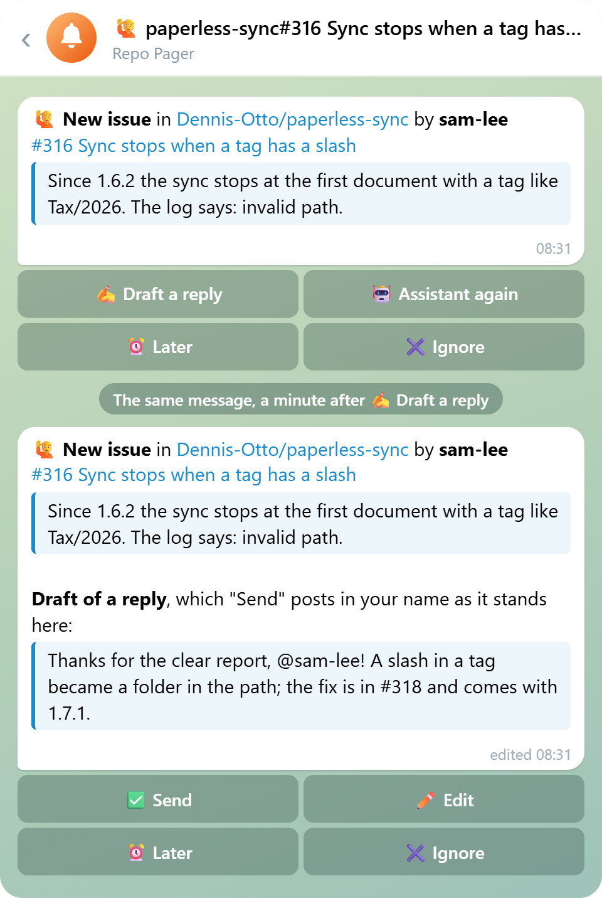
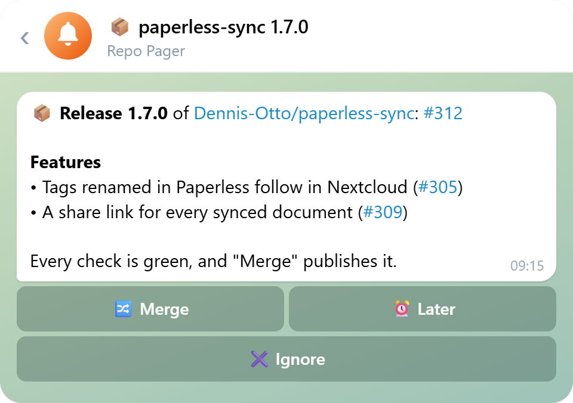
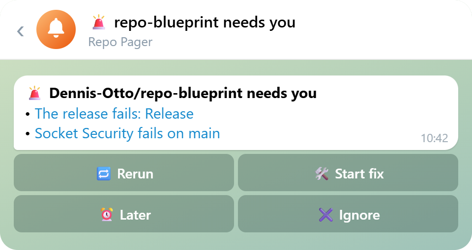
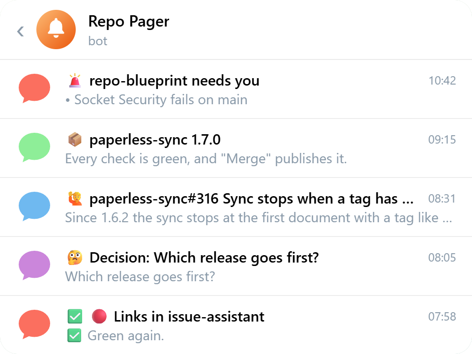

# How it works

The pager is a Cloudflare Worker with three doors and a schedule: `/github` for the events of the GitHub App, `/telegram` for the updates of the bot, `/control` for the answers of the private control repository, and a run every 15 minutes. Each request proves where it comes from before anything else runs. In a run of the schedule, each step and each thing of a step go apart from the others: a thing that Telegram or GitHub refuses, or that a network that breaks stops, costs only itself, goes to the log of the Worker and comes again in the next run, while the other things and the later steps, above all the events that failed, still run. As many things come again as the calls of a run allow, eight each, and the rest wait for the next run ([decision 0023](decisions/0023-a-thing-that-fails-in-a-run-of-the-schedule-costs-only-itself.md)).

<picture>
  <source media="(prefers-color-scheme: dark)" srcset="images/diagrams/how-the-pager-works.dark.svg">
  
</picture>

## What counts

`src/rules.ts` is the one place that decides; its tests go through each rule. The pager serves the repositories of the maintainer, `MAINTAINER_LOGIN`, and of the further owners that `OWNERS` names, such as an organization; an event of a repository of another owner, or of a kind that isn't listed here, ends without a message. Who counts as the maintainer stays `MAINTAINER_LOGIN`, in the repositories of `OWNERS` too.

| Event | Counts when | Becomes |
| --- | --- | --- |
| `issues` opened, `pull_request` opened | Its author is neither the maintainer (`MAINTAINER_LOGIN`) nor a bot; a pull request from a fork counts too when its branch is named like one of release-please, since only a branch of the repository itself makes a release | A contribution, one message each |
| `discussion` created, `discussion_comment` created | Its author is neither the maintainer nor a bot, the discussion isn't one of the maintainer, and no answer of Q&A was chosen | A contribution with its draft at once, one per discussion; a new comment makes itself the message that the reply answers ([below](#a-discussion)) |
| `discussion` answered, closed or deleted; `discussion_comment` created by the maintainer | The discussion isn't one of the maintainer | Its open thing is done, and its message says why ([below](#a-discussion)) |
| `issue_comment` created, `pull_request_review` submitted, `pull_request_review_comment` created | Its author is neither the maintainer nor a bot, on an issue or a pull request of neither; a review that says nothing but its comments in the code comes as those comments | The newest message of its contribution: an open thing names it in place and notifies once, a thing whose reply went or that GitHub dealt with opens again, and an unknown one comes as new ([below](#a-comment-on-an-issue-or-a-pull-request)) |
| `pull_request` synchronize, reopened or ready_for_review; `issues` reopened | Someone other than the maintainer or a bot did it, on a pull request or an issue of neither | News of its contribution, without a draft: an open thing names it in its note and notifies once, a thing whose reply went or that GitHub dealt with opens again, and an unknown one comes as new ([below](#new-commits-a-reopen-and-ready-for-review)) |
| `issue_comment` created, `pull_request_review` submitted or `pull_request_review_comment` created by the maintainer; `issues` closed; `pull_request` closed and merged or not | The issue or the pull request is neither of the maintainer nor of a bot | Its open thing is done, and its message says why ([below](#a-comment-on-an-issue-or-a-pull-request)) |
| `check_run` completed on the default branch | The check is required by the rulesets of the branch and failed, timed out or didn't start, and isn't a job of GitHub Actions, whose run pages as its workflow | An entry of the alarm of the repository; a pass of the same check takes it out |
| `workflow_run` completed | `release.yml`, `build-release.yml` or `verify-release.yml` failed, outside a pull request | An entry of the alarm; a pass that belongs to the failure takes it out: a later attempt of the run that failed, a run started by hand, or any pass after which no release is a draft any more |
| `workflow_run` completed on the default branch | Any other workflow failed, timed out or didn't start, in a run of the repository itself outside a pull request, such as one of a push, a schedule, a bot or a start by hand | One message per workflow, once a rerun didn't help; each run that fails again edits it, and a run that passes the jobs that failed turns it ✅ ([below](#a-workflow-that-fails-on-main)) |
| `issues` opened by a bot | It has the label `bot-failure` of the bot-health bot | The pager reads the run that the issue names and takes it as the end of that run of its workflow, also at each edit, as the bot makes one at each new failure: a failure that the pager had changes nothing, and one that it missed pages now. Without a run that it can read, an entry of the alarm, which an edit changes and the closing of the issue takes out. The issue *Upload the new social preview*, with the key `social-preview` in its marker, names no run and fails nothing: the bot keeps it open while GitHub shows another picture than the committed `.github/social-preview.png`, which only a person can upload, so its entry says *🖼 Upload the new social preview* and links the issue, with the picture to save and the way to the settings. 🛠 Start fix can't make the upload: an alarm with only this entry, or this entry and events of GitHub that fail, offers none, and 🛠 Start fix of an alarm with other entries leaves it out |
| `code_scanning_alert` created, appeared_in_branch or reopened on the default branch | Its severity is high or critical, and nobody dismissed it | An entry of the security message of the repository; fixed or dismissed takes it out. An alert that code scanning found first in a pull request comes as appeared_in_branch once the merge brings it to the default branch |
| `secret_scanning_alert` created, reopened or publicly_leaked | The alert isn't resolved | An entry of the security message of the repository, with the kind of its secret and its file, never the secret; resolved takes it out ([below](#a-vulnerability-report-and-a-leaked-secret)) |
| `repository_advisory` reported | A private vulnerability report | A thing of its own, *🔐 Vulnerability report*, with its severity, its link and the days of `SECURITY.md`, never what it says ([below](#a-vulnerability-report-and-a-leaked-secret)) |
| `repository_advisory` published | It is a report that the pager shows | The same message: *✅ Published* |
| `check_suite` completed on a branch of release-please, or its `pull_request` edited | GitHub calls the pull request clean: open, of the repository itself, no draft, into the default branch, every required check green and up to date | The release message with its notes and 🔀 **Merge**; new notes at the same head edit it in place |
| `pull_request` synchronize, closed and merged; `release` published | It is the release that the message shows | The same message: *updated*, *merged*, *✅ published* |
| `workflow_run` completed | `visual.yml`, the visual check, passed on a pull request of the repository at its head, which is one of the maintainer or of a bot, and a picture looks different | The pictures that look different, their changed pixels in red first, then before and after, in the topic of the release or of a thing of their own ([below](#the-pictures-of-a-visual-change)) |
| `pull_request` closed | It is one of the maintainer or of a bot whose pictures the pager shows | Its pictures are done: ✅ in front of their topic |

A bundle whose last entry is gone turns green by itself, and a new failure after that opens a new message, which notifies. A new entry of an open bundle, such as a release that fails while a check of the alarm waits for its fix, or a leaked secret while a code-scanning alert does, is news as well ([decision 0022](decisions/0022-a-new-entry-of-an-open-bundle-notifies-once.md)): the message, edited in place, lists it, and a short message below it in its topic, *🚨 New in this alarm* or *🛡 New in this security message* with the entry, notifies, since an edit notifies nobody. The new entries of the ten minutes after a notice of the bundle, such as a push that breaks a few checks or the alerts of a new query of code scanning, come quietly, and a bundle that ⏰ **Later** put aside comes back at once. An entry that is there already and changes, such as a check that fails again, edits the message, quietly, and GitHub's second delivery of the same event changes nothing. An entry of the alarm keeps the run of GitHub Actions that failed, where it names one: a release run by its id, and an issue of the bot-health bot whose run the pager can't read by the run in the marker of its body, `<!-- bot-health {"run": 31, …} -->`, which the bot writes anew at each failure. Such an entry gives the alarm 🔁 **Rerun**. The entry of a release leaves the alarm only with a pass that belongs to its failure: a run of a push or of the schedule passes as soon as it finds nothing to release, also while the release that failed is still a draft, which only a run started by hand or a later attempt of the failed run takes up. So a later attempt of the run that failed, such as one of 🔁 Rerun, and a run started by hand take the entry out; any other pass takes it out only when none of the ten newest releases of the repository is a draft any more, which the pager reads with a token of the app for `contents: write`, since GitHub lists drafts only to a token that may write the contents. Releases that can't be read keep the entry. A draft that the maintainer keeps on purpose, such as one started by hand, holds the entry of a release in the same way, until a later attempt of the failed run or a run started by hand takes it out.

A message shows what its thing says, so that it needs no visit to GitHub. A contribution quotes the first 500 characters of its issue, pull request, discussion or comment, without the HTML comments of its form, escaped and folded as `<blockquote expandable>`, in the room that its draft and its note leave below the 4096 characters of Telegram. A release shows the notes of its pull request, after `<!-- The notes of the release follow. -->` or else the first `---`: headings in bold, items as *• text #56* with the number linked and the links to commits left out, at most 15 lines or 1200 characters and *… and N more* for the rest, below *⚠️ Breaking changes* when the notes have a section of breaking changes or the major version goes up from 1 or above. A pager that speaks another language than English shows them in its own, as [the notes of a release in your language](#the-notes-of-a-release-in-your-language) says.

<picture>
  <source media="(prefers-color-scheme: dark)" srcset="images/screenshots/chat-contribution-en.dark.png">
  
</picture>

## The notes of a release in your language

The repositories write their changelogs in English, and GitHub keeps them so. A pager in German shows the notes of a release in German all the same ([decision 0020](decisions/0020-the-notes-of-a-release-come-in-the-language-of-the-pager.md)):

- **The headings at once,** from the catalog of the pager: the kinds of change of release-please, of the blueprint and of Keep a Changelog, such as *Neue Funktionen* for *Features*, *Fehlerbehebungen* for *Bug fixes* or *Bug Fixes*, and *⚠ Inkompatible Änderungen* for *⚠ BREAKING CHANGES*. A heading that names no kind of change stays as it is.
- **The items a minute later,** from the control repository: once the message went out in English, the pager sends `pager-translate` with the words of each item and text, without its scope, such as `deps:`, which stays as it is, and the control repository's Claude translates them with the maintainer's subscription, never with an API key. Its answer edits the message in place, which notifies no one.
- **Checked, line by line:** a translated line that lost a reference, such as #791, or a name of code, such as `anchore/syft`, `v1.56.0`, `node_modules` or `.github`, that says nothing or is longer than 450 characters keeps its English; an answer with another number of lines, or longer than 2400 characters in all, changes nothing.
- **Once per notes:** the record of the release keeps the translation, so a later change of its message, such as *merged* or a new head with the same notes, asks nothing again. Notes that change, such as by an edit of the pull request, ask anew, and so does a pager that speaks another language since; until its answer comes, it shows the English. An ask that failed, such as on a broken network, goes again with the event that GitHub delivers again, or with the next check of the release.
- **English when it doesn't come:** a control repository that doesn't answer, or one without the job for `pager-translate`, leaves the English, and so does a pager in English, which asks for nothing.

<picture>
  <source media="(prefers-color-scheme: dark)" srcset="images/screenshots/chat-release-en.dark.png">
  
</picture>

<picture>
  <source media="(prefers-color-scheme: dark)" srcset="images/diagrams/the-notes-of-a-release.dark.svg">
  
</picture>

## The buttons

`src/buttons.ts` is the allowlist: each kind of thing offers these buttons in these states, and a press runs only when the thing, as it is at the time of the press, still offers it.

| Thing | State | Buttons |
| --- | --- | --- |
| Contribution | new | ✍️ Draft a reply, 🤖 Assistant again (issues only), ⏰ Later, ✖ Ignore |
| Contribution | drafting | ⏰ Later, ✖ Ignore |
| Contribution | draft | ✅ Send, ✏️ Edit, ⏰ Later, ✖ Ignore |
| Discussion | new | ✍️ Draft a reply, ✖ Ignore, only when its draft couldn't be asked for, or its job failed or didn't answer within the hour |
| Discussion | drafting | ✖ Ignore |
| Discussion | draft | ✅ Send, ✏️ Edit, ✖ Ignore |
| Contribution, discussion | sent, done, ignored | None; a new comment of someone else opens one that was sent or done again: an issue or a pull request with the buttons of *new*, a discussion with its draft at once (*drafting*) |
| Alarm | open | 🔁 Rerun (where an entry names a run), 🛠 Start fix (unless every entry is an event of GitHub that fails or the upload of the social preview), ⏰ Later, ✖ Ignore |
| Security | open | 🛠 Start fix (unless every entry is a secret), ⏰ Later, ✖ Ignore |
| Alarm, security | fixing | ⏰ Later, ✖ Ignore |
| Vulnerability report | open | ⏰ Later, ✖ Ignore |
| Workflow | failing | 🔁 Rerun, ✖ Ignore |
| Workflow | rerunning | ✖ Ignore |
| Release | ready | 🔀 Merge, ⏰ Later, ✖ Ignore |
| Pictures | open | ✖ Ignore |
| Reminder | open | ✅ Renewed, ⏰ Later |
| Question of an agent | open | One button per option (no ⏰ Later, no ✖ Ignore) |

- **🔀 Merge** asks GitHub for the pull request again and squash-merges it only at the head that the message showed, while it is still clean; a changed release goes back to waiting for its checks.
- **✅ Send** posts the draft whose version its button carries, exactly as the message showed it, in the maintainer's name, and in a discussion as the app; an older button of the same thing refuses. **✏️ Edit** asks for the new text in reply to its prompt, and shows it as the next draft, which is the maintainer's own from then on: no draft of the control repository replaces it, not even that of a job which still runs. Each prompt waits a day for its answer, apart from the others, so prompts of several drafts, or two of one draft, can wait at once, and a reply to any of them becomes the draft of its own thing, never a question to the control repository.
- **🤖 Assistant again** starts the workflow `issue-assistant.yml` of the repository on the issue with `override`, in the maintainer's name. A repository whose issue assistant doesn't take the override yet answers 422, and the button says so.
- **🔁 Rerun** reads each run that the entries name, with a token of the app for `actions: read`, and runs its failed jobs again, as *Re-run failed jobs* on GitHub does, with a token for `actions: write`. A run that still runs, or whose newer attempt runs, and one that passed on a retry stay as they are, and the button says so. The entries of a run that runs again show *🔁 running again…* in the message, edited in place, until the run fails again or passes: a pass closes the issue of the bot-health bot or ends the failure of the release, which takes the entry out, and the last one turns the alarm ✅. It costs no run of Claude, so it comes first, for a short outage of GitHub, such as a download that answered 504. On the message of a [workflow](#a-workflow-that-fails-on-main), it runs the failed jobs of the newest run that failed again, after the same look, and the message says *🔁 The failed jobs run again…* until the run fails again, which edits it, passes, which turns it ✅, or is cancelled, by hand or by the concurrency group of its workflow, which brings 🔁 Rerun back with the note *⏹ The rerun was cancelled.*
- **✍️ Draft a reply** and **🛠 Start fix** send the thing to the control repository, whose answer comes back as below. Each is a run of Claude with the maintainer's subscription, which counts against its weekly limit, and the answer names its model, its effort and its tokens; a fix that finds an outage of GitHub or of a download in the logs, such as a 504, a timeout or `error connecting to api.github.com`, changes nothing and proposes 🔁 **Rerun** with one ✅ **Confirm** button; a job that fails brings its button back, and so does a job that sent no answer within the hour: the schedule gives its thing the buttons back once, as a new message with the note *⌛ No answer from the control repository*.
- **One button per option** answers the [question of an agent](#questions-and-reports-of-your-agents) and saves the answer; a text in its topic answers it in the maintainer's own words.
- **⏰ Later** brings the thing back as a new message after `LATER_HOURS`, unless it ends before: a thing that GitHub ends meanwhile, such as an issue closed there, an alarm whose last entry passed or a release merged on GitHub, forgets its Later, so its message promises no return and nothing comes back; a release that an update takes back to ready keeps it. **✖ Ignore** closes it, and an ignored workflow stays quiet until a run of it passes.
- **Once GitHub has acted,** the pager keeps it, whatever Telegram answers. A button that merged, posted, started a run of Claude, a rerun or the issue assistant, or saved the answer to a question, keeps the new state of its thing also when Telegram refuses the change of the message, such as in an outage or with a 429 that asks to wait long: the press still gets its answer, a second press of a button that the old message still shows is refused as out of date instead of acting on GitHub twice, and the next change of the thing shows the right message.
- **Every press gets an answer.** A press whose handling fails unexpectedly, such as when Telegram refuses the change of the message before GitHub was asked, Workers KV fails or GitHub can't be reached, gets the alert *😢 The pager failed on this press, and whether it acted is uncertain*, instead of a button that shows its loading state until Telegram gives up; look at the thing on GitHub, then press again. The error goes to the log of the Worker, as before.

<picture>
  <source media="(prefers-color-scheme: dark)" srcset="images/screenshots/chat-alarm-en.dark.png">
  
</picture>

<picture>
  <source media="(prefers-color-scheme: dark)" srcset="images/diagrams/the-rerun-of-a-run.dark.svg">
  
</picture>

## A workflow that fails on main

GitHub mails the actor of each run that fails, and the pager's agents act as the maintainer: a workflow that keeps failing, such as one whose download broke in an outage of GitHub, sends a mail per run. The pager pages for it once, in one message per workflow, so that the mails of GitHub Actions can go off ([Set up](setup.md#later-on)).

<picture>
  <source media="(prefers-color-scheme: dark)" srcset="images/diagrams/a-workflow-that-fails.dark.svg">
  
</picture>

- **What counts:** a run of any workflow but those of a release, which have the alarm, that ends as *failure*, *timed out* or *startup failure* on the default branch, in a run of the repository itself outside a pull request: a push, a schedule, a bot such as *Findings* or *After the checks*, or a start by hand on `main`. A run of a pull request, of another branch or of a fork means nothing, and neither does one that was cancelled or skipped: a pull request shows its checks itself. A job of GitHub Actions that a ruleset requires is a part of its run and pages with it, and an issue of the bot-health bot counts as the run that it names.
- **Once a rerun didn't help:** *After the checks*, the bot of the checks of the blueprint, runs the failed jobs of the tests and of a release once more within minutes. So the failure of a first attempt waits, unseen: once `WAIT` of `src/pager.ts`, 10 minutes, is over, the schedule reads the run. A rerun that still runs gets 10 minutes more, one that passed ends the thing without a message, and otherwise its message comes, 10 to 25 minutes after the failure. A rerun that failed too, the second attempt or a later one, shows at once.
- **One message per workflow,** such as *🔴 Docs fails on main in Dennis-Otto/player-switch-for-autodarts*, in a topic of its own: the jobs that failed in the attempt that failed last, at most five, each linked to its log, or the run when GitHub doesn't list them, and when it failed. Each run that fails again edits it in place, without a notification: *Failed 3 times since 2026-11-08 at 08:47 UTC, the last time on 2026-11-08 at 11:20 UTC.*
- **Green again:** a rerun of the run that failed that passes, or a newer run in which no job that failed ran without passing, turns it ✅. A newer run that skipped such a job, as *After the checks* runs one job per event, ends nothing, and a job that it doesn't list any more is gone from the workflow. The next failure opens a new message in its topic, which notifies.
- **🔁 Rerun** runs the failed jobs of the newest run that failed again; **✖ Ignore** keeps the workflow quiet until a run of it passes.
- **A rerun that is cancelled,** by hand or by the concurrency group of its workflow, ends without a result: the message, edited in place, fails again with 🔁 Rerun and the note *⏹ The rerun was cancelled.* Any other cancelled run means nothing, as before.
- **What it costs:** a failure reads the jobs of its attempt once, with a token for `actions: read`, and writes its thing once; a pass reads the jobs of its run only while its workflow fails, and writes only when it ends the thing; a cancelled run reads its thing once and writes only when it ends a rerun of 🔁 Rerun. The app needs no new permission and no new event: it has `workflow_run` and *Actions* already.

## A discussion

A new discussion, or a comment on one, by someone other than the maintainer or a bot is a contribution as well, with a topic of its own, such as *💬 demo#31 How do I start?*. The pager asks the control repository for its draft as it comes, since its buttons send, edit or ignore that draft, as [decision 0006](decisions/0006-a-discussion-gets-its-draft-at-once-and-the-reply-of-the-app.md) explains: the message shows the discussion, or the comment with its author, and *✍️ The control repository drafts a reply…*, and the draft follows with ✅ **Send**, ✏️ **Edit** and ✖ **Ignore**. ✅ Send posts exactly that draft with `addDiscussionComment` of GitHub's GraphQL API, with a token of the app for `discussions: write` of that one repository, so the reply shows as that of the app: on the discussion itself, or in the thread of the comment that it answers, which for a reply to a reply is the thread of its parent, since GitHub nests one level only. A draft that couldn't be asked for, as when the app isn't installed on the control repository, leaves the message with ✍️ **Draft a reply** and a note that says why.

A discussion is one thing, keyed by its number, which GitHub counts together with those of issues and pull requests. A new comment of someone else makes itself the message that the reply answers, with a new draft: while the thing is open, a new message replaces the old one, and once its reply went, the thing opens again in its topic, where the old message stays as history. A discussion that the maintainer ignored stays ignored, until its record expires 30 days later. No thing comes from a discussion of the maintainer, comments included, since GitHub tells its author of each comment itself, from one of Q&A whose answer was chosen, or from the app's own replies, which come back as comments of a bot.

A discussion that GitHub dealt with needs no reply of the pager, as pictures need none once their pull request closed: when the maintainer replies on GitHub itself, to the discussion or in any of its threads, when someone marks an answer, or when the discussion is closed or deleted, its open thing is done. Its buttons go, its topic gets ✅, and its message says why, such as *💬 You replied on GitHub, so the pager sends nothing.*, edited in place, which notifies nobody. A job that still drafts for it finds the thing done, and its draft isn't shown. A new comment of someone else opens it again afterwards, as it does once a reply went, unless an answer was chosen.

A draft that the maintainer wrote with ✏️ Edit stays his ([decision 0009](decisions/0009-a-discussion-that-github-dealt-with-is-done-and-an-own-draft-stays.md)). A job that was still drafting when his text came, such as one for a newer comment, no longer replaces it: its draft goes into the topic of the thing as a message to read, without buttons, and ✅ Send still posts his text. A new comment of someone else keeps it too: the new message shows the comment with his text as its draft, a note says so, and no job drafts another one, so ✏️ Edit is how it changes for the new comment.

The control repository runs the jobs of one thing one at a time. A comment that comes while the draft of an older one is still being written waits for it: the pager shows the new comment at once, drops the older draft when it comes, so that no reply to the older comment can go into the thread of the newer one, and asks for the draft of the newest comment then. ✅ Send posts on the discussion itself when the comment that it answers is gone, as GitHub's `NOT_FOUND` for it says, so that the approved reply isn't lost.

<picture>
  <source media="(prefers-color-scheme: dark)" srcset="images/diagrams/the-reply-to-a-discussion.dark.svg">
  
</picture>

## A comment on an issue or a pull request

A comment of someone other than the maintainer or a bot on an issue or a pull request of someone else, a review of such a pull request and a comment in its code, such as a reply in the thread of a review, the usual place of an answer to one, is the newest message of its contribution, which the reply answers, so that an answer to the maintainer's question reaches the chat, as a new comment on a discussion does ([decision 0011](decisions/0011-a-comment-on-an-issue-or-a-pull-request-edits-its-thing-and-notifies-once.md)). An issue or a pull request of the maintainer or of a bot makes no thing, comments and all, since GitHub tells its author of each comment itself, and a comment of a bot, such as one of the issue assistant, means nothing.

- **An open thing** keeps its message: it names the comment and its author, such as *💬 New comment on an issue in demo by hubot*, with the link to the comment, edited in place, which notifies nobody. So one message below it in its topic does, *💬 hubot commented: #12 It breaks*, and in a chat without topics as an answer to its message. A message that went anew, as when the maintainer deleted its topic, names the comment and notifies itself, without a second one below it. The comments that follow within ten minutes edit the message alone, so a few quick comments notify once. A draft that the maintainer asked for is written again for the comment: a job that still drafts drops its draft when it comes and asks for the next one, and a draft that is shown goes, and a new one is asked for at once. A text that he wrote with ✏️ Edit stays his draft, as in a discussion, with a note that a new comment came.
- **A thing whose reply went**, or that GitHub dealt with, opens again in its topic with ✍️ **Draft a reply**, where the old message stays as history, as a new message, which notifies.
- **An ignored thing** stays ignored, until its record expires 30 days later.
- **An unknown thing**, from before the pager or whose record expired, comes as a new one.

The same comment twice, as GitHub delivers an event again when its answer was lost, changes nothing. A comment of the maintainer on GitHub itself, and the issue closed or the pull request closed or merged, make the open thing done, as for a discussion: its buttons go, its topic gets ✅, and its message says why, such as *💬 You replied on GitHub, so the pager sends nothing.*, *Closed on GitHub.* or *🔀 Merged.*, edited in place. ✍️ Draft a reply then sends `issueComment` with the thing, the comment that the reply answers. All this needs the event *Issue comment* of the app, which its permissions *Issues* and *Pull requests* cover; without it, a thing still closes with its issue or pull request.

A review comes the same way ([decision 0026](decisions/0026-a-review-new-commits-and-a-reopen-are-news-of-a-contribution.md)). Its message says *💬 New review of a pull request in demo by hubot*, and its notice *💬 hubot reviewed: #14 Fix it*, with the text of the review as its quote; a comment in the code is a *New comment on a pull request*. A review that says nothing itself, as GitHub makes one for each reply in the thread of a review comment, comes as that comment, while an approval or a request for changes without words is news as it is. A review or a comment in the code of the maintainer is his reply on GitHub, which makes the thing done, so the usual way of a review, his request for changes, ends it until the contributor answers. A review and a comment in the code have ids of their own, so the pager compares each with the newest of its kind, and the draft names it as `review` or `reviewComment` in place of `issueComment`. All this needs the events *Pull request review* and *Pull request review comment* of the app, which its permission *Pull requests* covers.

<picture>
  <source media="(prefers-color-scheme: dark)" srcset="images/diagrams/the-comments-of-a-contribution.dark.svg">
  
</picture>

## New commits, a reopen and ready for review

What a contributor does without a word after the first message, the fix pushed after a review, a pull request or an issue reopened, or a draft made ready for review, is news of its contribution as well ([decision 0026](decisions/0026-a-review-new-commits-and-a-reopen-are-news-of-a-contribution.md)). Such an activity of someone other than the maintainer or a bot, on a pull request or an issue of neither, works as a comment does, but without a word to quote or to answer, and without a draft: a draft that is shown stays, for the maintainer to send, edit or draft again.

- **An open thing** keeps its message, edited in place with a note such as *🔁 New commits by octocat.*, *🔓 Reopened by octocat.* or *👀 Ready for review, says octocat.*, and one message below it in its topic notifies, such as *🔁 octocat pushed new commits: #14 Fix it*. The comments and activities of ten minutes notify once together, so a push right after a reply in a review is one notice.
- **A thing whose reply went**, or that GitHub dealt with, such as with the maintainer's request for changes, opens again in its topic as a new message, which notifies, with the note and what its reply answers.
- **An ignored thing** stays ignored, and **an unknown thing** comes as a new one.

A push of the maintainer or of a bot, such as a branch that a bot brings up to date, and a reopen of either mean nothing. The pager keeps the time at which GitHub changed the pull request or the issue with each kind of activity, so GitHub's second delivery of the same event changes nothing. These are actions of the events *Pull request* and *Issues*, which the app has already.

## The pictures of a visual change

A repository whose pictures show its app, such as paperless-unified-search, runs a visual check on each pull request that changes what they show: its `visual.yml` renders the pictures again, compares each with the committed one by its pixels, and keeps each one that looks different in an artifact of its run, before and after, with `report.json`, their list with the share of the pixels that changed. When the check passed on a pull request of the maintainer or of a bot, the pager shows those pictures in the chat, as [decision 0007](decisions/0007-the-pictures-of-a-visual-change-come-from-the-artifacts-of-its-check.md) explains:

- **Whose:** the pager asks GitHub for the pull request first. One of someone else, one from a fork, whose run names no pull request, and one that moved on to a newer head get nothing: what someone else's pull request renders is theirs, and a newer head brings a check of its own.
- **Where:** the release pull request that the pager shows gets them in the topic of the release, below a message of their own, so that its own message keeps 🔀 **Merge**; when the maintainer deleted that topic, they open a new one, with the release's own message first. Any other gets a thing of its own, such as *🖼 demo#8 Make it blue*, whose message lists the pictures that look different, with how much of each changed, and links the run of the check, whose artifacts have them all, *the changes in red* only when they hold the comparison or the difference of one. Its one button is ✖ **Ignore**, which stops its pictures; the merge or the close of the pull request ends it, with ✅ in front of its topic.
- **What:** an album, with `sendMediaGroup` of the Bot API, of the largest changes, as many as their photos fit into the ten of an album ([decision 0027](decisions/0027-the-album-of-a-visual-change-shows-one-comparison-per-picture.md)). A picture whose check drew its comparison shows that one photo: the place of its change before and after in one picture, of the same frame, the changes framed in red, with the caption *🔍 Before and after, frame 4 of 7: `de/setup.webp`, changed, 0.66 % of its pixels*, without the frame for a picture of one frame. Without a comparison, a picture shows the picture of its difference first, *🔴 Changed pixels*, each changed pixel in red, when its check drew one, then before and after ([decision 0016](decisions/0016-the-album-of-a-visual-change-shows-the-changed-pixels-first.md)); an animation, by the `frames` of the report or by the headers of its file, shows its difference alone, as *one frame of the animation* or the frame that the report names, since Telegram shows only the first frame of each side. A photo is a PNG or WebP file of at most 5 MB, of a size that Telegram takes as one. A GIF shows its difference alone, which is a PNG, and is one of the largest changes by how much it changed; one without a difference, a video and a larger file stay behind the link, and a difference that is missing, broken or too large leaves its picture before and after. The album right after a new message comes quietly, so that both notify once.
- **How often:** one album per head of the pull request at most. A check that runs again at the same head sends nothing, and a newer head whose pictures look different edits the message in place, with an album that notifies. A newer head whose pictures all look as committed again says so in the message, in place; a pull request whose pictures never changed sends nothing at all.
- **How:** with a token of the app for `actions: read` of that one repository, which the app has for 🔁 **Rerun**, so no secret is new. The pager lists the artifacts of the run, `visual` or one per language, such as `visual-en`, and asks GitHub for the ZIP of each, 32 MB at most together, which answers with the address of its storage, signed for a minute. The pager follows it without the token, which goes to GitHub alone, reads the ZIP in memory, and inflates only the report and the pictures of the album, never to more than the size that the ZIP gives them. It reads the reports of each repository: their list is `pictures` or `images`, a picture is new or added, deleted or removed, and its files are named in its entry or are its path in `before/` and `after/`. The difference of a picture that changed is the file that its entry names as `diff`, as the blueprint's `keep` writes it from a coming release on, or as `difference`, as homedarts-for-autodarts does, or for a PNG its path in `diff/`. Its comparison is the PNG that its entry names as `comparison`, with the frame that it shows as `frame`, from 1, of `frames`, as the visual check of the blueprint writes it from a coming release on.

<picture>
  <source media="(prefers-color-scheme: dark)" srcset="images/diagrams/the-pictures-of-a-visual-change.dark.svg">
  
</picture>

## A vulnerability report and a leaked secret

The blueprint turns on private vulnerability reporting and secret scanning in every repository, and `SECURITY.md` promises to acknowledge a report within 7 days and to assess it within 14. Without the pager, GitHub tells of either only by mail.

<picture>
  <source media="(prefers-color-scheme: dark)" srcset="images/diagrams/a-vulnerability-report.dark.svg">
  
</picture>

- **A private vulnerability report** (`repository_advisory` reported) is a thing of its own, *🔐 Vulnerability report in demo*: its id, linked to the advisory, its severity as the reporter gave it, or *not rated yet*, and the two days of `SECURITY.md`, counted from the day of the report, such as *📅 Acknowledge it by 2026-11-11 and assess it by 2026-11-18*. It offers ⏰ Later and ✖ Ignore, and its advisory published ticks it ✅.
- **What it says stays on GitHub.** A report is under embargo until its advisory is published, and a chat of Telegram isn't encrypted end to end: the message never shows its summary or its description, Workers KV keeps neither, no log and no answer to GitHub names either, and a text in its topic gives the control repository the message as the maintainer sees it: the repository, the id and its link, the severity and the two days, never what the report says. Neither 🛠 Start fix nor a draft of Claude sees a report.
- **One reminder, on the day before.** Six days after the report, the schedule asks GitHub for the state of the advisory, and for nothing else of it, with a token of the app for `repository_advisories: read` (`src/advisories.ts`). Still in *triage*, its message comes again, which notifies, with *⏰ Still in triage on GitHub: acknowledge it by 2026-11-11*; accepted as a draft, it needs no reminder; closed, withdrawn or published on GitHub, its message says so. When GitHub doesn't tell the app the state, the reminder comes all the same: one reminder too many is better than a promise missed. A report that reaches the pager after its sixth day gets none, since its first message just notified.
- **A secret that secret scanning found** (`secret_scanning_alert` created, reopened or publicly_leaked) is an entry of the security message of its repository, *🛡 Security in demo*, next to the alerts of code scanning: the kind of its secret and the file in which it was found first, such as *🔑 Mailchimp API Key in config/.env*, and *leaked in public too* once GitHub found it in public as well. The file comes from the places of the alert, `GET /repos/{owner}/{repo}/secret-scanning/alerts/{number}/locations`, with a token for `secret_scanning_alerts: read`: neither they nor the webhook carry the secret, and the pager never reads the alert itself, whose answer would. A secret found outside a file, such as in an issue, is listed without one. Resolved takes the entry out, and a security message of secrets alone offers no 🛠 Start fix: a secret that leaked is revoked where it was issued, which no change of the code does. Where code scanning is in the message as well, 🛠 Start fix sends the control repository its alerts of code scanning alone. A late copy of an event from before a secret was resolved, as the schedule may ask for one, changes nothing: the pager keeps the time of the resolution for four hours, and only an event that came after it, such as the secret found again, brings the entry back.

## The control repository

The workflow of the maintainer's private control repository, which `CONTROL_REPOSITORY` of `wrangler.jsonc` names, such as `OWNER/repo-pager-control`, runs Claude Code with the maintainer's own subscription. Every control repository is a private copy of [the public template of the control repository](https://github.com/Dennis-Otto/repo-pager-control-template), whose README describes its jobs, its safety and its set-up, and takes the template's changes by a pull request of its workflow *Template* ([decision 0019](decisions/0019-the-control-repository-comes-from-a-public-template-which-every-copy-follows.md)). The pager sends it a [repository dispatch](https://docs.github.com/rest/repos/repos#create-a-repository-dispatch-event), with a token of the app for that repository alone:

| Event type | Sent by | Client payload |
| --- | --- | --- |
| `pager-draft` | ✍️ Draft a reply, and a discussion or a comment on one as it comes | `item`, `repo`, `number`, `pull`, `language`; for a discussion also `discussion`: `true` and `comment`, the GraphQL id of the comment that the reply answers, if any; for an issue or a pull request that a comment opened or changed, `issueComment`, the id of that comment in the REST API, or `review` or `reviewComment`, the id of a review or of a comment in the code of a pull request in the REST API, which a control repository from before them ignores |
| `pager-fix` | 🛠 Start fix | `item`, `repo`, `kind` (`alarm` or `alert`), `entries` with `label` and `url`, without a secret, without the upload of the social preview and without an entry whose `url` is not in `repo`, such as an event of GitHub on the app's *Advanced* page, each `label` cut to 300 characters, `language`; with no such entry, the button answers so and sends nothing. The `url` of a release run that failed names its attempt, such as `…/actions/runs/3/attempts/2`, so that the fix reads the jobs of that attempt and not those of a rerun that still runs |
| `pager-translate` | The message of a release in a pager that doesn't speak English, once per notes ([above](#the-notes-of-a-release-in-your-language)) | `item`, `repo`, `number`, `version`, `of` (the key of the notes, which the answer names), `lines` (the words of each item, without its scope, at most 15), `language` |
| `pager-text` | A text that answers no prompt and no [open question of an agent](#questions-and-reports-of-your-agents) | `text`, the words below a photo or a file as well, 4000 characters at most: a longer text, such as a pasted log, gets an answer in its thread that says so, and goes nowhere; `message` (its id in the chat), `reply`: the first 1000 characters of the message that the text answers, or of the caption of a picture, if any, and `thing`: the thing whose topic the text came from, if any; `language` |

`language` is `LANGUAGE` of the Worker, `en` or `de`: the control repository answers the maintainer in it, the note of a fix and the reason of a job that failed included, while a draft of a reply keeps the language of its issue or pull request.

A text in reply to a message of the pager is about its thing: *merge it*, in reply to the message of a release, names that release. So is a text in the topic of a thing, which carries the thing as `thing`: its `id`, `kind`, `repo` and `state`, the `number` of a contribution or a release and the `version` of a release, `links` to where GitHub shows it (its issue or pull request, or the page of a bundle and its entries, 21 at most) and `text`, its message as the maintainer sees it, in the HTML of Telegram, with what comes from GitHub escaped, 1500 characters at most. The key is `thing`, not `item`: the control workflow runs the jobs of one `item` one at a time, and a text keeps a run of its own. A workflow that doesn't know `thing` passes it over, so either side may deploy first. The pager sends no text of an issue, not even the start that its message quotes: the workflow reads it from GitHub itself, as data. It answers with a `POST` to `/control`:

- the header `X-Pager-Timestamp`, the time in seconds since 1970, which may be five minutes off at most;
- the header `X-Pager-Signature`, `sha256=` and the HMAC with SHA-256, under `CONTROL_SECRET`, of the timestamp, a dot and the body;
- a body of JSON, one of those below.

The body is one of:

- `{"type": "draft", "item": "<id>", "text": "<reply>"}`: the draft of a reply for a contribution, at most 3000 characters, shown as a new message with ✅ Send. Once the maintainer wrote the draft himself, the draft of a job goes into the topic of the thing as a message to read, and his stays;
- `{"type": "note", "item": "<id>", "text": "<note>"}`: a note below a thing, such as the pull request of a fix. The note that ends a job, while the thing is still *fixing* (or a contribution *drafting*), comes in a new message, which notifies, as a failure does; another note edits the message of the thing in place;
- `{"type": "note", "text": "<answer>"}`: a message of its own, such as the answer to free text;
- `{"type": "proposal", "text": "<answer>", "action": "<action>", "target": {"kind": "<kind>", "repo": "<owner/name>", "number": <number>}}`: an answer to free text that proposes one action, as a message of its own with a single ✅ Confirm button;
- `{"type": "failed", "item": "<id>", "text": "<why>"}`: a draft or a fix that didn't come to be, such as when the weekly limit is reached. The thing goes back to the state before its button, with the reason as its note, in a new message, so that the button can run again;
- `{"type": "failed", "item": "<id>", "text": "<why>", "action": "rerun"}`: a fix that made no change and proposes one action of its alarm or alert, such as 🔁 Rerun when the logs show an outage of GitHub or of a download. The thing goes back as above, with the reason as its note, but its message keeps its place, and the answer comes in the thing's topic as a proposal, with a single ✅ Confirm button, which notifies. A thing that doesn't offer the action then, such as an alarm whose entries name no run, comes back as for any failed job. An older pager ignores `action`, so either side may deploy first;
- `{"type": "failed", "text": "<why>"}`: free text whose answer didn't come to be, shown as a message of its own;
- `{"type": "translation", "item": "<id>", "of": "<key>", "lines": ["<line>", …]}`: the notes of a release in the language of the pager, one line for each line of its `pager-translate`, in their order and without their scope, which edit its message in place. Notes that changed since, or a pager that speaks another language since it asked, answer 409, an answer that doesn't fit them 422, and the same answer again changes nothing. A translation that didn't come to be sends nothing, never a `failed` with the `item`, which would put a note on the release: its message keeps the English;
- `{"type": "health"}`: the check of the workflow *Health*, once a day, which the pager answers with its [health](#the-health-of-the-pager), as JSON, and which changes nothing.

An answer to free text, a note or a failure without `item` or a proposal, carries `"message": <id>`, the `message` of its `pager-text`. The pager then turns the 👀 on that text into 👍, or into 😢 for a failure; a job started by hand in the Actions tab has no text, and leaves it out. The answer goes into the thread of that text, as [the thread of an answer](#the-thread-of-an-answer) says.

Each body may carry what the run of Claude took from the weekly limit of the subscription:

```json
"usage": {
  "turns": 4,
  "seconds": 52,
  "effort": "high",
  "models": [{"model": "claude-opus-5-5", "tokens": 48213}]
}
```

Each body may also name the day on which `PAGER_FIX_TOKEN` of the control repository expires, which its check *Health* reads from GitHub once a day, for its [reminder](#the-tokens-that-expire): `"tokens": {"fix": "2026-12-03"}`, or `{"fix": null}` for a token without a day. A value that the pager can't read is passed over, so that no draft fails over it, and an older pager ignores `tokens`, so either side may deploy first.

`effort` is the `--effort` that the workflow set: `low`, `medium`, `high`, `xhigh` or `max`. `models` names each model that worked, as many as five, with every token that it read and wrote, the cache included, from the `modelUsage` of the result in the transcript of the Claude Code action. The message shows it below the answer, on one line, in the language of the pager:

| Usage | English | German |
| --- | --- | --- |
| One model | *🧮 Opus 5.5 · high · 48,213 tokens* | *🧮 Opus 5.5 · Hoch · 48.213 Tokens* |
| Two models | *🧮 Opus 5.5 93%, Haiku 5.5 7% · extra high · 48,213 tokens* | *🧮 Opus 5.5 93 %, Haiku 5.5 7 % · Extra Hoch · 48.213 Tokens* |
| Without `models` | *🧮 Claude: 4 turns, 52 s, from your weekly limit* | *🧮 Claude: 4 Runden, 52 s, von deinem Wochenlimit* |

A model goes by its short name, such as *Opus 5.5* for `claude-opus-5-5`, *Haiku 3.5* for `claude-3-5-haiku-20241022` and *Fable 5.1* for `claude-fable-5-1`; an id of another form stays as it is. The effort in German is *Niedrig*, *Mittel*, *Hoch*, *Extra Hoch* or *Max*, and an effort that the pager doesn't know yet stays as Claude Code names it.

A proposal names its thing as the control repository knows it, and the pager looks it up:

| Action | Kind of thing | `number` |
| --- | --- | --- |
| `merge` | `release` | none |
| `assistant`, `draft` | `contribution` | the issue, pull request or discussion |
| `fix` | `alarm`, `alert` | none |
| `rerun` | `alarm` | none |
| `later`, `ignore` | any of the four | for a contribution |

✅ Confirm carries the data of the thing's own button, so a press runs the action only while the thing still offers it, as any press does, and then the button goes. A thing that the pager doesn't show, or that doesn't offer the action now, gets the answer without a button. The `action` of a failed fix names no `target`: it is the thing of the job. ✅ Send and ✏️ Edit can't be proposed: they stay with the message of the draft, which shows the text that they post.

```sh
body='{"type":"note","text":"The fix is in #12."}'
stamp=$(date +%s)
signature=$(printf '%s.%s' "$stamp" "$body" | openssl dgst -sha256 -hmac "$PAGER_CONTROL_SECRET" -r | cut -d' ' -f1)
curl -s "$PAGER_URL/control" -H "X-Pager-Timestamp: $stamp" -H "X-Pager-Signature: sha256=$signature" -d "$body"
```

No body makes the pager act: whatever the control repository sends is shown, escaped, and never run, and every action needs the press of a button of the allowlist. The answer goes to the Worker rather than straight to Telegram, as [decision 0003](decisions/0003-the-control-repository-answers-the-worker.md) explains: the token of the bot stays in Cloudflare, and the Worker keeps the state that a draft, a failed job and a proposal need.

## Questions and reports of your agents

The maintainer's own agents, such as an orchestrator that runs on their PC through the night with `gh` signed in as them, ask through the pager instead of leaving a line in a report: a question comes as a thing of its own, in a topic of its own, with its options as buttons, and the agent reads the answer from the private control repository. No secret goes to the PC: `gh` sends the event and reads the answer with the maintainer's own sign-in.

<picture>
  <source media="(prefers-color-scheme: dark)" srcset="images/diagrams/a-question-of-an-agent.dark.svg">
  
</picture>

An agent sends one of three [repository dispatches](https://docs.github.com/rest/repos/repos#create-a-repository-dispatch-event) to the control repository:

| Event type | Client payload | What the pager shows |
| --- | --- | --- |
| `pager-ask` | `id`, `question`, `options` | A topic *🤔 Decision: …*, with one button per option |
| `pager-withdraw` | `id`, and `reason` if any | The question loses its buttons, and its message says that the agent took it back |
| `pager-report` | `text`, and `title` if any | A topic *🧾 Run: …*, or *🧾 Run* without a title, with the report and no button |

```sh
gh api repos/OWNER/repo-pager-control/dispatches --input - <<'JSON'
{"event_type": "pager-ask", "client_payload": {"id": "2026-11-08-merge-order", "question": "Which release goes first?", "options": ["The blueprint", "The pager"]}}
JSON
```

The workflow of the control repository takes only an event that the owner of the repository sent, never one of the GitHub App or of anyone else, checks it as the pager does and sends it on to `/control`, signed as every answer:

- `{"type": "ask", "id": "<id>", "question": "<question>", "options": ["<option>", …]}`: the `id` names the answer, with letters, digits, dots, dashes and underscores, 64 characters at most, starting with a letter or a digit; the `question` has 1000 characters at most; two to four `options`, each different and 64 characters at most, become the buttons, one a row. The same `id` again asks nothing new: an open question stays as it is, and the pager answers 409 for one that is answered already. An answered `id` keeps its file on `pager-answers` for good and can't be asked again, so each question takes a new `id`, with the date or the run in it, such as `2026-11-08-merge-order`: the agent would read the old answer as the choice for its new question. Without the GitHub App on the control repository, the pager answers 503, since it couldn't save the answer;
- `{"type": "withdraw", "id": "<id>", "reason": "<reason>"}`: the agent no longer needs the answer, such as after its wait gave up and it went on without one. An open question loses its buttons, its message says that the agent took it back, with the `reason`, 500 characters at most, below it, and its topic gets ✅; nothing is saved on `pager-answers`. The same `id` again changes nothing, the pager answers 409 for a question that is answered already, whose answer stands for the agent to read, and 404 for one that it doesn't know, never asked or forgotten 30 days after its end. A question taken back keeps its `id` used: asked again, it gets 409;
- `{"type": "report", "text": "<report>", "title": "<title>"}`: the report of a run, its first 3000 characters, with a `title` of 100 characters at most, which the pager leaves out of its store.

A press saves the answer in the control repository, as the GitHub App, with a token for that repository alone and its permission to write the contents, which it has for the dispatches already: the file `answers/<id>.json` on the branch `pager-answers`, which its first answer makes with a commit of its own, without a parent and without the code of the repository, so no workflow runs on it.

```json
{
  "id": "2026-11-08-merge-order",
  "question": "Which release goes first?",
  "options": ["The blueprint", "The pager"],
  "choice": 1,
  "answer": "The pager",
  "answered": "2026-11-08T07:12:03.000Z"
}
```

A text that the maintainer writes in the topic of an open question is its answer in his own words, for when none of the options fits ([decision 0010](decisions/0010-a-text-in-the-topic-of-a-question-answers-it-and-an-agent-may-take-it-back.md)): the pager saves it in the same file, with `choice` `null` and the text as `answer`, so that the agent reads it as it reads a button, and gives the text a 👍. It takes 1000 characters at most; a longer one, and one that GitHub refuses, gets an answer in the topic that says why, and the question stays open. Once a question is answered or taken back, a text in its topic goes to the control repository, as in the topic of any other thing.

```json
{
  "id": "2026-11-08-merge-order",
  "question": "Which release goes first?",
  "options": ["The blueprint", "The pager"],
  "choice": null,
  "answer": "Neither: wait for the release of Paperless.",
  "answered": "2026-11-08T07:14:40.000Z"
}
```

The message then shows the answer, its buttons go, and its topic gets ✅. When GitHub refuses the answer, the button says why and the question stays open, so that a press saves it again. A question takes no ⏰ Later and no ✖ Ignore: an agent waits for it. The agent reads the answer with its own `gh`, which answers 404 until there is one, for an `id` that was never asked before:

```sh
gh api -H "Accept: application/vnd.github.raw+json" "repos/OWNER/repo-pager-control/contents/answers/2026-11-08-merge-order.json?ref=pager-answers"
```

The script `scripts/ask.mjs` of the control repository does all of it, as its README describes: it asks, takes a question back, reports and waits for an answer. `ask` prints the time of its question, and `wait` and `answer` with `--since` and that time ignore an older answer, such as that of an earlier question with the same `id`.

## The reaction on a text

A text to the bot shows where it is with one reaction, which the pager changes as the job goes on: a bot may set one reaction per message, from the fixed list of `ReactionTypeEmoji` in Telegram's Bot API. That list has no ✅, so 👍 stands for an answer, the closest to it, and 😢 for none. A text that never reached a job gets its 😢 at once, with a message in its thread that says why: one that GitHub refused, such as when the app may no longer dispatch to the control repository, names GitHub's reason, and one whose handling failed otherwise, such as on a broken network, says that the pager failed on it. Neither waits for an answer. A text that did reach its job gets no such message for a failure after that, such as of its 👀: its answer can still come, and writing it again would start a second run of Claude.

<picture>
  <source media="(prefers-color-scheme: dark)" srcset="images/diagrams/the-reaction-on-a-text.dark.svg">
  
</picture>

The jobs of the control repository take 40 minutes at most, so the pager waits an hour for the answer: the schedule, every 15 minutes, gives the 😢 to a text that still waits after that, between 60 and 75 minutes after it went. An answer that comes later still turns it into 👍, in the thread of its text.

The pager reads text only. The words below a photo, a file or a voice message, which Telegram sends as its caption, are its text, with the same reaction, while the picture, the file or the voice itself stays in Telegram: a screenshot with *is this the bug they mean?* reaches the control repository as those words. One that has no words gets no reaction, but an answer in its thread at once, *The pager reads text only: write it as a message, or put your words below the photo or the file.*, and `/help` says the same, so that nothing the maintainer sends goes without a sign. The service message of a topic, such as one that the maintainer opened or renamed, stays without an answer.

## A topic per thing

Telegram's Bot API 9.4 lets a bot open topics in its private chat, with `createForumTopic`, once Threaded Mode is on for the bot in the Mini App of @BotFather ([Set up](setup.md#1-the-bot-of-telegram)). Then the first message of each thing opens a topic of its own, named after its repository, without its owner, and what the thing is, with a color per kind:

<picture>
  <source media="(prefers-color-scheme: dark)" srcset="images/screenshots/chat-topics-en.dark.png">
  
</picture>

| Thing | Name of its topic | Color |
| --- | --- | --- |
| Contribution | 🙋 demo#12 It breaks | blue |
| Discussion | 💬 demo#31 How do I start? | blue |
| Alarm | 🚨 demo needs you | red |
| Workflow | 🔴 Docs in demo | red |
| Security | 🛡 Security in demo | yellow |
| Vulnerability report | 🔐 Vulnerability report in demo | red |
| Release | 📦 demo 1.2.3 | green |
| Reminder | 🔔 Token of Claude | violet |
| Question of an agent | 🤔 Decision: Which release goes first? | violet |
| Report of a run | 🧾 Run: Night run | green |

<picture>
  <source media="(prefers-color-scheme: dark)" srcset="images/diagrams/a-topic-per-thing.dark.svg">
  
</picture>

- **Everything about the thing is in its topic.** Its message with the buttons comes first, and its changes edit it in place, as before. A draft, the answer of 🛠 Start fix, a job that failed, the message that ⏰ Later brings back, the prompt of ✏️ Edit and the answers to texts written in the topic follow there.
- **A text in the topic of a thing is about that thing.** It goes to the control repository with the thing as `thing`, as the table above says, so a question such as *why?* needs no more words. A topic that the maintainer opens, and General, have no thing: a text there starts a conversation of its own, as before. A text in the topic of an open [question of an agent](#questions-and-reports-of-your-agents) is its answer instead.
- **One topic per thing, never one per change.** The bundle of what fails in a repository keeps its topic, also when it opens again after it turned green, and so does its security message. A new version of a release that is still shown keeps the topic of the one that it replaces, renamed; the next release, after one was published or ignored, gets its own.
- **✅ once it is done.** A thing that is closed, or a release that is merged, gets ✅ in front of the name of its topic with `editForumTopic`, and a bundle that opens again loses it. A rename that Telegram refuses, such as after a burst of calls, marks the thing, and the schedule tries it again every 15 minutes, five topics per run at most, for a day, also once the thing is done: so the topic of a release follows its version and gets its ✅ after all ([decision 0020](decisions/0020-the-notes-of-a-release-come-in-the-language-of-the-pager.md)). Done topics stay, as the history of their things, as [decision 0005](decisions/0005-one-topic-per-thing-kept-when-done.md) explains: the maintainer deletes one by hand when it is no longer needed.
- **A deleted topic opens anew.** A topic that the maintainer deleted is done for him, and its messages went with it. So the next message of its thing, whichever it is, opens a new topic, named as the first, which the thing keeps ([decision 0017](decisions/0017-a-topic-that-the-maintainer-deleted-opens-anew-with-the-next-message-of-its-thing.md)): its own message, when it changes or ⏰ Later brings it back, or a message below it, such as the pictures of a release, the notice of a new comment, a draft to read or a proposal with ✅ Confirm, which brings the thing's message with its buttons into the new topic first. A thing that sends nothing more, such as a done one, stays without a topic.
- **Topics of the maintainer.** The service message `forum_topic_created` of a topic that the maintainer opens is passed over, and each text in it is answered in it. Telegram may send the first text of a topic opened on a phone without its thread: its answer then goes into the main view.

Without topics, the pager writes into the main view, as before, and the thing works as it did:

- `getMe` doesn't say `has_topics_enabled`, since Threaded Mode is off;
- Telegram refuses `createForumTopic`, as it did for every new topic of a private chat from 9 November 2026 with `BOT_TOPIC_WRONG_HOME` ([tdlib/telegram-bot-api#944](https://github.com/tdlib/telegram-bot-api/issues/944)), while it still left its notice *"…" was created* in the main view, with no topic behind it, and the topics from before kept working;
- Telegram opens the topic but refuses the message in it with `message thread not found`, as a rollout of Telegram did in [tdlib/telegram-bot-api#847](https://github.com/tdlib/telegram-bot-api/issues/847): the pager deletes the empty topic again.

No bot can put a message into a topic that Telegram doesn't open, so the pager does two things when it refuses one ([decision 0021](decisions/0021-a-thing-that-telegram-kept-out-of-a-topic-moves-into-it-with-its-next-change.md)):

- **It pauses new topics.** For an hour, the pager asks Telegram for no new topic, so that a burst of new things leaves no burst of notices of topics that aren't there: a new thing, a report of a run and a message below a thing in the main view go there at once. Each refusal in a row doubles the pause, up to four hours, and the first topic that opens ends it.
- **It moves the thing into its topic once Telegram opens topics again.** An open thing that waits in the main view, such as *🔴 Docker E2E fails on main* in the outage above, gets a topic of its own with its next change: its message goes into the new topic, quietly, as an edit does, and the one in the main view is deleted; a message below it, such as the pictures of a release, brings it there first. A thing that is done stays in the main view, edited in place.

That holds for the new topic of a thing whose topic the maintainer deleted as well: when Telegram refuses it, the thing goes on in the main view, and its next message after the pause asks for a topic again. So does a thing that the pager up to 0.7.0 left in the main view when its topic was gone, such as a release whose versions carried that over: its next message opens a topic of its own, with the thing's message first. Only a thing from before topics stays in the main view.

The prompt of ✏️ Edit then answers the message of its thing, so that it is clear what it is about, and a thing from before topics stays in the main view until it closes. Each of these cases logs a warning with Telegram's answer, never the name of the topic or a text.

## The thread of an answer

Telegram's Bot API 9.3 gave the private chat of a bot threads, and with Threaded Mode on for the bot, in the Mini App of @BotFather, each new text of the maintainer can start a thread of its own. An answer to a text goes into the thread that the text came from, read from its `message_thread_id`: the answer to `/help`, an error such as a missing control repository or a draft that is gone, and the answer of the control repository, whether a note, a failure or a proposal with its ✅ Confirm button. The reactions need no thread, since they sit on the text itself.

<picture>
  <source media="(prefers-color-scheme: dark)" srcset="images/diagrams/the-thread-of-an-answer.dark.svg">
  
</picture>

The control repository never sees the thread: the pager keeps it with the text that waits for its answer, and the `message` of the answer finds it again, so the contract stays as it was. Some answers go into the main view instead:

- a text from General, the first thread, whose messages the Bot API takes without the id of a thread;
- an answer to no text, such as one of a job started by hand;
- an answer to a text that went before the pager knew threads, and one that comes more than a day after its text: the pager keeps the thread of a text that it gave up on for a day, so a late answer still finds it;
- an answer whose thread Telegram doesn't find, with `message thread not found`, such as one that the maintainer deleted: the pager sends it again without the thread and logs that, without its text.

The messages of the things, such as a release or a failing check, go into their topics, as [a topic per thing](#a-topic-per-thing) says.

## Texts and languages

Every text that the pager sends comes from `src/texts.ts`, one catalog per language, English and German, and `LANGUAGE` in `wrangler.jsonc` chooses one: the messages and their states, the buttons, `/help`, the answers of the buttons, the errors that it shows and the reminder of the token. A text names its parts in braces, such as `{repo}`, and what fills them, such as the title of an issue or the name of a check, goes in as GitHub says it. The rules hand on what they mean, such as why a release may not merge yet, as a key of the catalog with its values, and the pager words it; the logs stay in English. Both catalogs have the same keys, which the compiler checks, and the same placeholders, tags and emojis, which `test/texts.test.ts` checks: a new text takes an entry in both.

After a change of `LANGUAGE`, a message speaks the new language once its thing changes; what its record keeps as text, such as its note, the entries of a bundle and the reminder of a token that GitHub refuses, keeps the words that it was written with; the reminder of a token's day is written anew whenever it comes again.

## When an event fails

GitHub never delivers an event of a webhook again by itself. When handling one fails, such as when Telegram answers `429` or a `5xx`, or GitHub a `5xx` while the pager reads a pull request, the pager answers `500`, and the schedule takes it from there, in `src/deliveries.ts`:

<picture>
  <source media="(prefers-color-scheme: dark)" srcset="images/diagrams/when-an-event-fails.dark.svg">
  
</picture>

- **Each run reads the deliveries of the app's webhook** of the last three hours, newest first, with `GET /app/hook/deliveries`, 100 per page, on two lists, since a busy fleet brings more than one run can read: hundreds of workflow runs in a quarter of an hour, each with deliveries of its own. First the failures, `status=failure`, three pages at most, which reach back hours also on a busy day; then the deliveries of every outcome only back to the newest that the run before read, twenty pages at most, which bring the answers that didn't come in time, which the list of the failures leaves out, and the attempts that passed. What the next runs need of these, the answers that didn't come in time, the attempts asked for again that passed and the newest event that passed of each kind and repository, the run keeps for three hours in the storage of the Durable Object. When the pages end before they reach three hours, or the run before, the log of the Worker says so, with how far they reached. The attempts of an event share its `guid`, and each has an id of its own.
- **An event whose newest attempt failed comes again:** a `5xx` of the pager, or `0`, when no answer came within the ten seconds of GitHub. A `2xx` passed, and a `4xx` is a refusal of the pager, such as of a wrong signature, which it would refuse again. The schedule asks with `POST /app/hook/deliveries/{id}/attempts`, the oldest first, for ten events per run at most and three attempts per event, its first delivery included. It counts only an event whose first delivery it read, so that it knows all its attempts: an event older than three hours gets no more.
- **A second delivery is safe:** each signal leaves the same state when it comes twice, as `test/deliveries.test.ts` checks for every kind of signal. A contribution that is shown already, the same discussion or comment, the same entry of a bundle, a release at the same head and the pictures of the same head change nothing the second time, and no message goes.
- **A late event that a newer one overtook doesn't come again:** a redelivery comes up to 45 minutes late, and its signal would trust a payload that may be stale by then, such as a run that failed before a rerun passed, which would open the alarm again, or a release at a head that has moved since. So an event of a run, a check suite or a check, an alert of code scanning, an issue, a pull request, a discussion or a release doesn't come again once a newer event of the same kind in the same repository passed, which the list shows by its `event` and `repository_id`; the newer one stands, as before the pager asked for any event again. A comment adds to its thing and overtakes nothing, so it always comes again, and so do a vulnerability report, which a second copy shows once and none would miss, and an alert of secret scanning: one push brings one event per alert, a leak missed is worse than a late copy, and the time of a resolution keeps a late copy out ([above](#a-vulnerability-report-and-a-leaked-secret)). The rule is coarse: a newer event of another check or another pull request of the repository counts as well, and the failed one is then left out, as it was before. Since every workflow on `main` pages, this matters more: a push brings many events of runs, so a failure whose delivery failed is in practice left out and pages at the next failure of its workflow, or when the bot-health bot opens its issue at night.
- **A burst of messages waits a little:** when Telegram answers `429` and asks to wait three seconds at most (`retry_after`), the call waits and tries once more, which keeps a burst of events, also of those that come again, within the limit of the chat.
- **An event whose third attempt fails** is an entry of the alarm of the control repository, the pager's own: *🚨 An event of GitHub fails: pull_request.opened*, linked to the Advanced page of the app, where GitHub shows each delivery with the answer of the pager and offers **Redeliver**. It comes once, by the `guid` of the event, and an attempt that passes later, such as one asked for there, takes it out, which turns the alarm green when it was the last entry. An entry that the alarm shows already, also one that was ignored, stays as it is. An alarm with only such entries offers no 🛠 Start fix, since Claude sees neither the deliveries nor the logs of the Worker.
- **Within the free plan:** a request of a Worker makes 50 calls to the network at most. The deliveries come last in a run and count the calls of the steps before them: the pages of the failures and the redeliveries take what is left, and the pages of every outcome leave the calls of ten redeliveries and one change of the alarm, so that what they can't read waits for the next run; a run without room for a single one of them sees no pass since the run before, so it has nothing delivered again and leaves the alarm as it is, and the next run decides. Each change of the alarm needs room for ten calls; what doesn't fit comes in the next run. The pager writes nothing to Workers KV for the attempts, since the list of the deliveries counts them, and it signs one JWT of the app for all the calls of seven minutes.

This needs no permission of the app and no secret: the JWT of the app reads and asks for the deliveries of its own webhook.

## When the pager breaks

The pager writes only when something needs its maintainer, so a quiet day looks the same whether all is well or the pager is dead: a token of the bot that Telegram no longer takes, a webhook that stopped delivering, a schedule that no longer runs, a key of the app that GitHub refuses, or a token of the maintainer that expired. Two things tell the maintainer before that: the reminders of the tokens that expire, and a check of the pager's health once a day, from the control repository, whose failure GitHub reports by itself. Once the mails of GitHub Actions are off ([Set up](setup.md#later-on)), that failure comes only as a notification of GitHub on the web and in its app, so keep *Web and Mobile* on, or keep the mails of the control repository with a filter.

<picture>
  <source media="(prefers-color-scheme: dark)" srcset="images/diagrams/when-the-pager-breaks.dark.svg">
  
</picture>

### The tokens that expire

| Token | Used by | Where its day comes from | How to renew it |
| --- | --- | --- | --- |
| `CLAUDE_CODE_OAUTH_TOKEN` of the control repository | every job of Claude | `CLAUDE_TOKEN_EXPIRES` in `wrangler.jsonc` | `claude setup-token`, `gh secret set CLAUDE_CODE_OAUTH_TOKEN`, and the new day in `wrangler.jsonc` |
| `GITHUB_USER_TOKEN` of the Worker | ✅ Send on an issue or a pull request, 🤖 Assistant again | the header `github-authentication-token-expiration` of GitHub, which the schedule reads once a day | regenerate it on GitHub, then `npx wrangler secret put GITHUB_USER_TOKEN` |
| `PAGER_FIX_TOKEN` of the control repository | the pull request of 🛠 Start fix | `tokens.fix`, which the check *Health* of the control repository reads from the same header once a day | regenerate it on GitHub, then `gh secret set PAGER_FIX_TOKEN` |

- **Three weeks before a token's day,** a 🔔 reminder comes in a topic of its own, such as *🔔 GitHub token of the pager*, with the day and how to renew the token; ✅ Renewed closes it, and ⏰ Later puts it aside; when it comes back, it says how many days are left then, and when the token got a new day or is no longer watched in the meantime, it closes without a page. It comes once per token and day, so a renewed token with a new day reminds again three weeks before that day, and once more on the day itself, as a new message that notifies and says that the token has expired: whether the first is still open, put aside by ⏰ Later, or closed by ✅ Renewed while the day stayed the same. A token without a day, or a header that the pager can't read, reminds of nothing.
- **Once a day,** by the day in UTC, the schedule asks GitHub about `GITHUB_USER_TOKEN` with `GET /rate_limit`, which counts against no limit of the API, and reads the header of its answer: a fine-grained token expires after 30 days unless its maintainer chose another day. A new token is asked about at once, which the pager tells by a short hash of it in the storage of the Durable Object; the token itself is kept nowhere but in the secrets of Cloudflare. When GitHub fails to answer, the log says so and the next run asks again.
- **A token that GitHub refuses** with `401`, because it expired or was revoked, gets a reminder of its own, once until GitHub takes it again. ✅ Send and 🤖 Assistant again then answer *GitHub refuses GITHUB_USER_TOKEN: it expired or was revoked*, instead of a bare refusal.

### The health of the pager

The workflow *Health* of the control repository runs once a day and by hand, with `permissions: {}` at the top and only `contents: read` for its checkout, and sends `{"type": "health"}` to `/control`, signed as every answer of the control repository. The pager answers with JSON that names no secret:

```json
{
  "schedule": "2026-11-08T06:45:00.000Z",
  "failure": null,
  "telegram": {
    "ok": true,
    "webhook": true,
    "pending": 0,
    "lastError": {"at": "2026-11-07T21:12:03.000Z", "message": "Wrong response from the webhook: 502 Bad Gateway"}
  },
  "github": {"ok": true},
  "tokens": {
    "claude": {"expires": "2027-10-07"},
    "user": {"expires": "2026-12-03"},
    "fix": {"expires": "2026-12-04"}
  }
}
```

- `schedule` is when the schedule last ran to its end, which it notes in the storage of the Durable Object, or `null` when it never did. A run in which a thing failed doesn't come to its end, so a thing that keeps failing makes the schedule older than an hour.
- `failure` is the last thing that failed in a run of the schedule, or `null` when none ever did: `at`, when; `what`, the step and the thing by its id, such as `the things that come back, thing i3f0c9a1b2d4e5f6`; and `error`, the answer of Telegram or GitHub, such as `Telegram sendMessage: Bad Request: message is too long`. One after `schedule` is what the runs since haven't got past.
- `telegram` says whether Telegram takes the token of the bot, with `getMe`, and from `getWebhookInfo` whether a webhook is set, how many updates still wait for it, and its last error, if Telegram keeps one. A refusal is `{"ok": false, "error": "Telegram getMe: Unauthorized"}`.
- `github` says whether GitHub takes the key of the app, with `GET /app` and the JWT of the app; a refusal names GitHub's answer.
- `tokens` names what the pager knows of each token: its day, `null` for none, and for `user` also `refused`, the day since which GitHub refuses it. A token that the pager knows nothing of yet is left out.

The run fails, with an `::error::` that names what is wrong, when the pager doesn't answer, the schedule is older than an hour, Telegram refuses the bot, no webhook is set or it reported an error in the last day, GitHub refuses the app, or a token expires within a week or is refused. GitHub notifies the maintainer of a failed run of a schedule by itself, by mail and on github.com, which works also when Telegram or the Worker is the part that broke. The check takes about a minute of the private repository's Actions minutes a day, and no secret beyond the one that signs its answers.

## State

Workers KV holds one record per thing: its kind, state, repository, the id of its message, the thread and the name of its topic and, for a contribution, the start of its text, the draft, whether it is the maintainer's own, with the ids of the discussion and of the comment that its reply answers for a discussion, and for an issue or a pull request the id of the newest comment of someone else and when one last notified, for a release the lines of its notes that the message shows and their translation, and for a vulnerability report its id, its severity, its day and the day of its reminder, never what it says, and for the reminder of a token the day on which it expires and whether it said so; a closed thing expires after 30 days. A link from the thread of a topic to its thing, `topic:<thread>`, lets a text in the topic find it: one write when the topic opens and one when it is renamed, and it expires 30 days after its thing is done. The time of a "Later", that of a job of the control repository while its thing waits for the answer, the day of the reminder of a vulnerability report and the time at which Telegram first refused to rename its topic are in the metadata of its record, so the schedule finds what is due, what waits too long, what to remind of and what to rename with one list, the time at which an alert of secret scanning was resolved, with its number and nothing else, lives for four hours, the prompt of an edit lives for a day, and one record keeps the texts that wait for their answer, with the time that each went and the thread that it came from, so the schedule reads it once per run and writes it only when a text comes or goes. Each change of a thing is one write, as the free plan of Workers KV wants it. Nothing secret is stored, and the logs name the answers of the APIs only, never a token or the text of an issue.

Workers KV has no compare-and-swap, and a write shows in other places of the network only after a while. So the Worker hands every request that passed its checks of route and method to one Durable Object, `Serial` in `src/serial.ts`, which runs the changes one after another, in one place: two required checks that fail at the same moment end in one message with both, and a ✅ Send pressed twice posts once. The object is one of SQLite, which the free plan of Workers offers, and its own storage keeps only the pager's notes on itself: the time of the schedule's last run, written once per run that came to its end, the last thing that failed in a run, and what the pager knows of the tokens of GitHub, their days and the short hash that says which `GITHUB_USER_TOKEN` it checked. In Workers KV, a write every 15 minutes would take a tenth of its 1000 writes a day.
